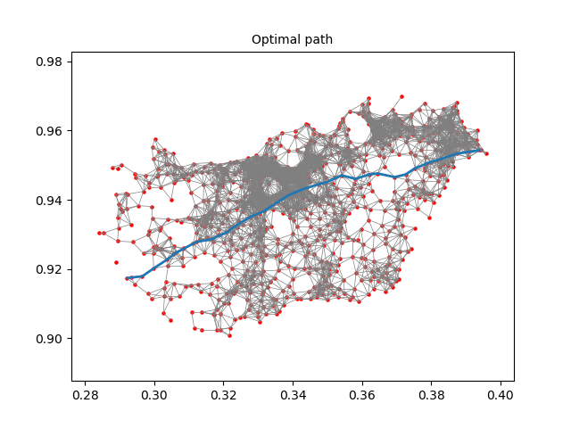

---
header-includes:
        - \usepackage[left=1.9cm, right=1.9cm, top=1.5cm, bottom=1.9cm]{geometry}
---

# DAT171 - Computer assignment 1
(2021-01-14)

**Note on collaboration:**
These assignments should be done in groups of 2.
Naturally you are encouraged to discuss the problem with your classmates, but it is important that you **do not send or receive entire chunks of code between groups**. Ask and answer questions, but please **avoid sharing code directly**.
In programming, the assignments are a major component to the examination and all the code will be run through automatic cheating detection software.
Of course, some functions are that simple to recreate and human judgment will always be used in cases with suspected cheating.

The first goal is to get you comfortable in using NumPy, SciPy and Matplotlib libraries.
The problem to solve is to construct a graph of neighboring cities and finding the cheapest path between two given cities, through the neighboring cities.
**See the example figure at the end of this document.**

Three files are supplied to test your program.
One very small `SampleCoordinates.txt` which is suitable for testing your routines.
In task 3 you need a radius that limits what is considered neighboring cities, in task 7 you need to enter start and end cities.
You can find these values in the table below (the city no. corresponds to the line in the respective city file).

| Filename                | Radius | Start city | End city |
|-------------------------|--------|------------|----------|
| `SampleCoordinates.txt` | 0.08   | 0          | 5        |
| `HungaryCities.txt`     | 0.005  | 311        | 702      |
| `GermanyCities.txt`     | 0.0025 | 1573       | 10584    |

The files listed above contain coordinates expressed in the format: `{a, b}` where a is the latitude and b is the longitude (in degrees).
Convert these using the Mercator projection to obtain the coordinates in xy-format:
$$
x = R \frac{\pi b}{180},\quad y = R \ln\left(\tan\left(\frac{\pi}{4} +\frac{\pi a}{360}\right)\right)
$$
The radii in the table are given for the normalized $R=1$.
*(Measuring distances on a Mercator projection isn’t very accurate, but will suffice for this task.)*

For convenience, the task it divided into steps as listed below.
Please stick to the given function prototypes, as it makes correcting reports much easier (you are of course allowed to write more sub-functions if you want).
*Functions must be documented using PyDoc.*

1. Create the function `read_coordinate_file(filename)` that reads the given coordinate file and parses the results into an array of coordinates.
   *Hints: Use the function `split` for the strings. Convert a string to a number with the function `float`. Make sure to use a NumPy type to store the data for performance (i.e. the function must return a 2D NumPy array).*
2. Write the function `plot_points(coord_list)` which plots the data points read from the file.
   *Hints: Remember to call `plt.show()` after plot commands are finished.*
   Create the function `construct_graph_connections(coord_list, radius)` that computes all the connections between all the points in coord_list that are within the radius given.
   Simply check each coordinate against all other coordinates to see if they are within the given radius.
   The cost for travelling between two neighbouring cities can be approximated by `cost=distance^(9/10)`.
   The output should contain the 2 indices in one NumPy array and the cost in another.
   *Hints: Have a look at the Python method `enumerate`.*
4. Create the function `construct_graph(indices, costs, N)` that constructs a sparse graph.
   The graph should be represented as a compressed sparse row matrix (`csr_matrix` in `scipy.sparse`)
   Construct the matrix with `csr_matrix((data, ij), shape=(M, N))`.
   *Hints: You need to provide a size N as input to this function. What is N? The SciPy manual contains examples on how to create the matrices:*
   <https://docs.scipy.org/doc/scipy/reference/generated/scipy.sparse.csr_matrix.html>
5. Extend `plot_points(coord_list, indices)` to also include the graph connections from task 3.
   *Hints: Use Matplotlib:s LineCollection instead of plotting the lines individually, since it is much faster.*
6. Find the cheapest path through the graph by using the functions in `scipy.sparse.csgraph`.
   Please make sure you document this function and what it does well!
   *Hints: The function dijkstra finds the cheapest path, it lets the user input what indices (starting nodes) the path should be computed for. This saves significant computational effort!*
   <https://docs.scipy.org/doc/scipy/reference/sparse.csgraph.html>
7. One of the outputs from the cheapest path functions in SciPy is a "predecessor matrix".
   The columns represent the predecessor when taking the cheapest path to the given column index (this seems complicated, but is actually a clever way to store the cheapest paths to every possible end node).
   Write a function `compute_path(predecessor_matrix, start_node, end_node)` that takes a predecessor matrix, start and end nodes, and converts it to a sequence of nodes that represent the cheapest path.
   *Hints: The simplest input file should generate the sequence `[0, 4, 3, 5]`, the total cost for this path is `0.21934542403665458`.*
8. Extend plot_points(coord_list, indices, path) to also include the cheapest path. Make the cheapest path more visible by making it stand out (thicker line width and a noticeable color for example).
   *Hints: LineCollection is again useful here.*
9. When you have checked that the results look good, have a look at the computational time (see table below).
   Which routine consumes most time?
   *Hints: Use time.time()*
10. Create the function `construct_fast_graph_connections(coord_list, radius)` that computes all the connections between all the points in coord_list that are within the radius given.
    This time, use the `cKDTree` from SciPy to find the closest coordinates quickly. (The `cKDTree` is an optimized version of the `KDTree`.)
    **Note!** You must be able to swap `construct_graph_connections` with `construct_fast_graph_connections` in your code (without any other alterations)!
    *Hints: Instead of checking a coordinate against all the other coordinates, we can filter the number of points by for example using the method `query_ball_points(coord, radius)` on the KDTree.*

For reference, here is the expected output for `HungaryCities.txt`:
Cheapest path from 311  to  702  is: `[311, 19, 460, 629, 269, 236, 740, 519, 571, 313, 218, 161, 158, 791, 615, 44, 395, 123, 580, 114, 253, 836, 73, 35, 424, 503, 789, 200, 702]`.
Total cost: `0.19371042011238568`

## Additional instructions

Besides the general *General instructions for computer assignments* please consider the items below for Computer Assignment 1:

1. Reading the input file:
   - Process each line as it is read.
   - Use `strip`, `split` and so on for processing each line, not indexing or similar.
   - Remember to close files.
2. As part of the report, the resulting pictures must be handed in. Make sure the pictures have a correct aspect-ratio.
3. The output of the program must include the total cost and the *shortest path* found.
4. Timing information for the major routines must be provided.
   On a quite old machine (Intel Core i7-2600) the following results (to one digit precision) can be used as a hint on the expected results for `GermanyCities.txt`:

| function | time (s) |
|----------|----------|
| `read_coordinate_file` | 0.03 |
| `construct_graph_connections` | 70 |
| `construct_graph` | 0.002 |
| Task 6+7 | 0.007 |
| `plot_points` (from task 8, excluding plt.show) | 2 |
| `construct_fast_graph_connections` | 0.3 |
| Running the entire program using the fast version, excluding plotting | 1 |

## What should be handed in?
Your hand-in should contain the following:

- A working, documented code (preferably in one flat file) for all tasks above.
- Plots for all three input-files.
- The results (i.e. list of cities in cheapest path and total cost) for all three input-files.
- Timing information corresponding to the table above  for Germany (at least).

Make sure to look through the "General instructions for Computer Assignments" document before handing in.

Good luck!
