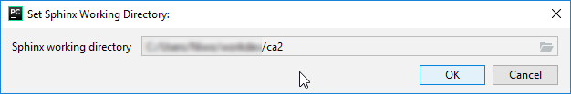
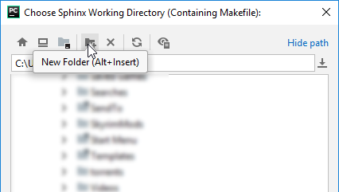
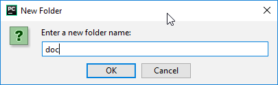
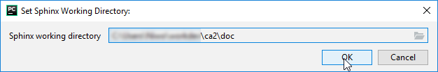
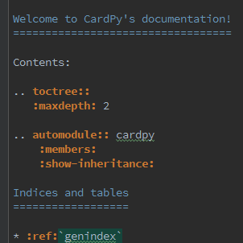
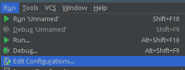
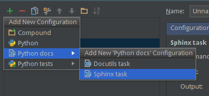
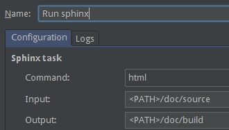
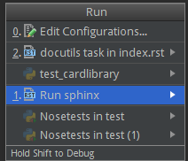
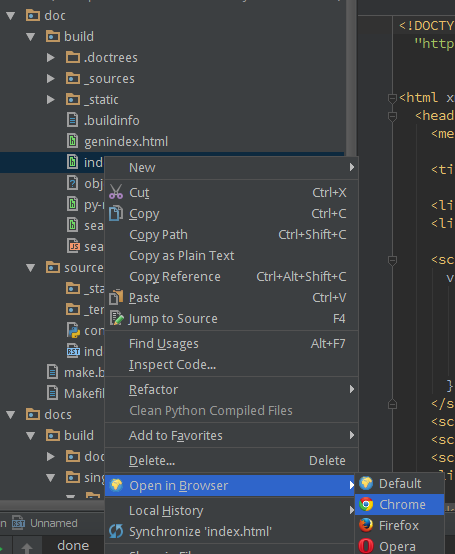

---
header-includes:
        - \usepackage[left=1.9cm, right=1.9cm, top=1.5cm, bottom=1.9cm]{geometry}
---


# DAT171 - Computer assignment 2
### (2020-02-12)

This assignment will focus on Object Oriented Programming (OOP). The objective is to write a general library for standard playing cards (52 card decks). This library will be used in assignment 3 to build a simple Texas Hold’em poker game.

The OOP-part of the assignment will try out the possibilities for:

1. Writing classes
2. Using inheritance and abstract functions
3. Operator overloading
4. String conversion methods

**Please read through the whole assignment before you start working!**

The task is set up as a top-down design, where the top level functions are written before the core functionality is implemented. Insert placeholders as you go along!

You are not required to follow the provided task order. On the next page are specifications of what is required of your library.

**See the requirements below.**

A suggested procedure for tackling this assignment is detailed in these steps, though the order does not really matter:

1. Create the card classes
2. Create a basic hand class (skip `best_poker_hand` method for now)
3. Create a class to represent the deck
4. Create a class to represent poker hands (with poker hand we mean for example a pair, flush or straight)
5. Implement `best_poker_hand` which computes the best poker hand from *an arbitrary set of cards*

In addition to creating the library itself you will generate a manual from your written docstrings, and write tests to ensure functionality does not regress as you keep making changes to the code. *It is best to work on documentation and testing continuously while you work on the assignment, not as a last step.* Guides on documentation and testing are provided later in this document.

Note that you do not have to create a playable game in this assignment but feel free to try if you want to. It can be a very simple game where you make up the rules for yourself.

Optional step: Create a class to represent a `Player` for a Texas Hold’em poker game (e.g. a `Hand`, name and betting money + associated methods). _This question overlaps with the next assignment, where such a Player class will be put into use._


## Requirements

The library must be called “cardlib.py” and should contain classes with associated methods and functions that are helpful for creating many types of card games. In particular, it must contain **_classes_** that represent:

1. The playing cards: The classes listed below **must** inherit from an abstract base class `PlayingCard`. They must be comparable with the < and == operators, and a method `get_value()` must be overloaded in each subclass. The following constructors **must** exist:
    1. `NumberedCard(value: int, suit: Suit)`
    2. `JackCard(suit: Suit)`
    3. `QueenCard(suit: Suit)`
    4. `KingCard(suit: Suit)`
    5. `AceCard(suit: Suit)`
    
    Implement < so that it gives a strict, sensible ordering, but you will have to decide what to do with Aces and suits yourself (hint: look at how tuples handle <). The method `get_value` is intended to help you practice implementing an abstract method, i.e. it should be included even if the need isn’t obvious for this simple class.

2. A class representing the hand: The `Hand` class must have methods for adding a new card, dropping several cards (based on an index list), and sorting the cards.
   There must also be a method `best_poker_hand(self, cards=[])` which computes the best hand out of the cards in the hand and cards in the input argument.

   The `best_poker_hand` method returns a `PokerHand` object. It must be able to handle a total of more than 5 cards (as is the case in Texas Hold ’em).  See *[Wikipedia List of poker hands](https://en.wikipedia.org/wiki/List_of_poker_hands)*

3. The deck: The class `StandardDeck()` must create a full deck of (52) cards. There must be functions for shuffling and taking the top card (which removes the card from the deck).

4. The poker hand (for a lack of a better name): A `PokerHand` must contain a hand type (high card, one pair, two pair, three of a kind, straight, flush, full house, four of a kind, straight flush) and the highest value(s). The `PokerHand` must overload the < operator in order to be able to compare which `PokerHand` is valued highest based on the hand type and value(s) of the cards in the best hand.

5. Testing code for most of the functions you have written (see below for tutorial)

6. HTML-documentation for everything above generated using Sphinx (see below for tutorial)

You are free to introduce additional methods as you see fit. Simple types, like the `Suit` and the type of poker hand, **must** be represented by an `Enum` type, not raw integers or strings. All classes should be printable in a nice way. Hint: Unicode characters can be used: *[Wikipedia](https://en.wikipedia.org/wiki/Playing_cards_in_Unicode)*.

You should hand in **a .zip file **with your library, your tests, and your manual (both the generated manual and the source files needed to run Sphinx to generate the output). Try to avoid non essential/scrap files in the zip file.


## Appendix A: Testing guide

As the code base you (and your collaborators) are working on becomes bigger, automatic testing becomes more important. As you make changes, if there are no tests, it is easy that things that previously worked stops working.

In this assignment you should create a set of tests that can be run automatically and report back if there are any errors. This is easier than it might sound due to powerful testing toolkits like *[pytest](https://docs.pytest.org)* that comes with Anaconda and is integrated into PyCharm.

Below are a few steps to help you get started.

*   Create a new folder in your project called “`test`”.
*   Create a Python file in the new folder, call it for example “`test_cardlib.py`”
*   To start, put the following in the file

    ```python
    import pytest

    def test_math():
        assert 1 + 1 == 2
        assert 2 * 2 + 3 == 7
        # It is important to also test strange inputs,
        # like dividing what zero and see that good exceptions are thrown.
        # What happens if you try to create a card with numerical value 0 or -1?
        with pytest.raises(ZeroDivisionError):
            1 / 0
    ```

*   To run the tests, right click the test folder and choose “`Run pytest in test`”.  You should get the output that it worked.
    (If you don’t find “`Run pytest in test`” in the menu, please go to `Settings -> Tools -> Python Integrated Tools` and make sure `Default test runner` is set to _pytest_.)
*   Try to make a test fail (by asserting `1 == 2` for example) and see what happens.
*   For the computer assignment we want most methods you implement to have a test. Be evil towards yourself! Try to break your code.
*   Add your own tests as you progress with your card library.
*   There are other testing tools, like nose, nose2, unittest, unittest2, which basically achieve the same.


## Appendix B: Documentation guide

In addition to the normal documentation of the code, you must also generate a HTML (or PDF) manual for the API of your library, using the tool *[Sphinx](http://www.sphinx-doc.org/en/stable/)*. This section will give a short tutorial how to generate such a manual from within PyCharm.

Start by going to `Tools -> Sphinx Quickstart`. The first time you run this in a project, it will ask for a working directory. For this project, choose “[project directory]/doc” by creating a new folder.









Next, Sphinx Quickstart will ask some questions in a terminal. Most of them can be answered with the default answer (by pressing Enter), but the following questions should be answered like this:

    > Separate source and build directories (y/n) [n]: y
    > autodoc: automatically insert docstrings from modules (y/n) [n]: y

If you do not get the second question, please go to `doc/source/conf.py`, find the lines

    extensions = [\
    ]


and change them to read:

    extensions = ['sphinx.ext.autodoc']

We now need to tell Sphinx what to document. Here we will do the the simplest possible and just ask Sphinx to generate documentation for the whole module. Go to `doc/source/index.rst` and enter:

    .. automodule:: <MODULE NAME>
                
        :members:
                    
        :show-inheritance:


Feel free to add some introduction, examples, whatever.

This document uses the restructured text format, see *[http://www.sphinx-doc.org/en/stable/rest.html](http://www.sphinx-doc.org/en/stable/rest.html)*.

Now to actually creating the manual. Create a new run configuration by going to `Run -> Edit configuration`. 



Press the `+` and chose `Python docs -> Sphinx task`.



Give the task a name and enter the paths for the input (source) and output (build) inside the doc folder. Here you can choose if you want to generate HTML or PDF (or many other formats) for the documentation. The easiest is HTML but if you have latex installed, feel free to try the PDF version.


Finally, go to `Tools -> Run…` and run the Sphinx task to generate the documentation.



To view the generated documentation, open the `doc/build/index.html` file in a web browser. This can be done by finding the file in the PyCharm file tree, right-clicking, and choosing `Open in Browser`.

