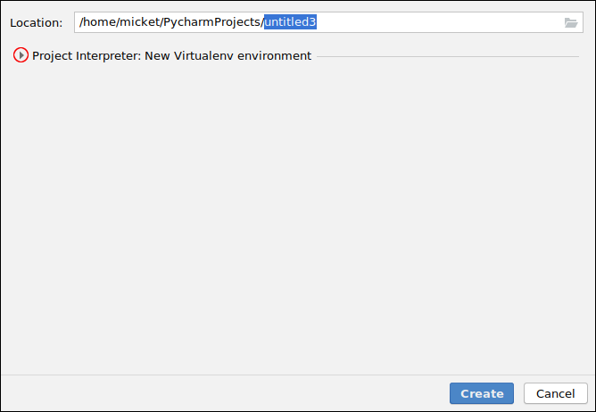
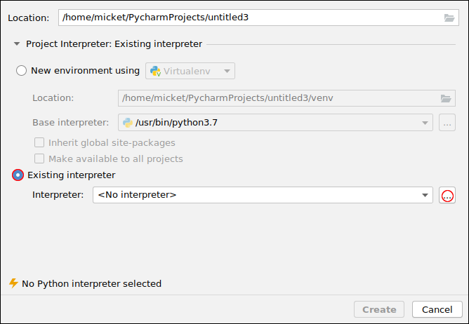
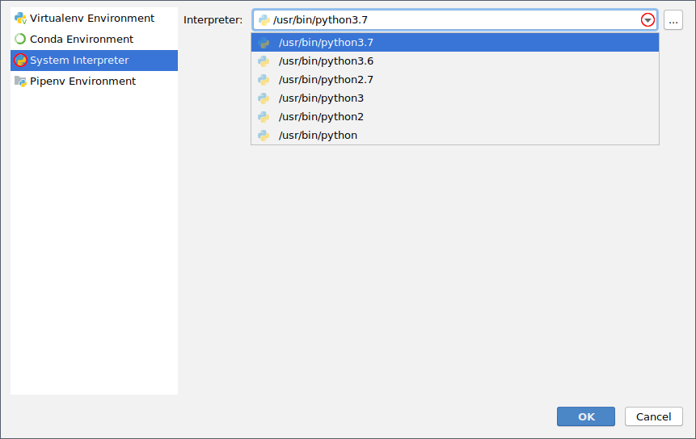
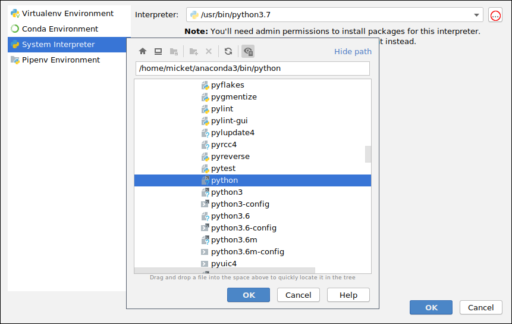

# DAT171 Object oriented programming in Python

* Teachers:
    * Thomas Svedberg, tel. 772 1522, <thomas.svedberg@chalmers.se>
    * Mikael Öhman, tel. 772 3191, <mikael.ohman@chalmers.se>
    * Kim Auth, <kim.auth@chalmers.se> 
* Find Thomas and Kim at Material & Computational Mechanics (3rd floor M-building)
* Find Mikael at Physics / C3SE office (5th floor Origo building)
* We are working from home some times, better contact us through mail first.

Course literature:

* C. Horstmann: Python for everyone (*optional*, permitted on exam)
* Reference manuals (available on exam)
* Lecture notes (available on exam)
* Python.org tutorial


# Prerequisites
Good knowledge of basic programming structures such as variables, conditions, loops, and functions in any programming language.

+-------------------------------+-----------------------------+
| Matlab                        | Python                      |
+===============================+=============================+
| ```matlab                     | ```python                   |
| function [r] = norm(x)        | def norm(x):                |
| s = 0;                        |     s = 0                   |
| for i = 1:length(x)           |     for i in range(len(x)): |
|    s = s + x(i)^2;            |         s += x[i]**2        |
| end                           |                             |
| r = sqrt(s);                  |     return sqrt(s)          |
| ```                           | ```                         |
+-------------------------------+-----------------------------+


# Course evaluation
  * Course evaluated at 2 occurrences
  * Course survey after exam
  * Course board representatives:
    * TKMAS
      * Walther Ericsson Porsenklev, <gusporwa@student.gu.se>
      * Jacob Nir, <jacob.nir@hotmail.com>
      * Daniel Söderqvist, <soderqvist.daniel@outlook.com>
      * Gabriel Wendel, <gabrielwendel990217@gmail.com>
    * TKIEK
      * Lucas Aronsson, <lucasaronsson@hotmail.com>
    * MPMOB
      * Xinhao Wang, <wangxinhao17@foxmail.com>
      * Shijie Zhang, <473664881@qq.com>


# Content
* Basic building blocks of a Python program (variables, conditional statements, loops, libraries, functions, errors)
* Data structures (lists, sets, dictionaries, tuples)
* Object Oriented programming (classes, objects, inheritance, polymorphism, abstract classes)
* NumPy (Matrices, vectors, linear algebra)
* SciPy (Package for numerical computations)
* Matplotlib (Plotting)
* Qt for creating graphical user interfaces and *interactive* programs
* Interactive Python (IPython/Jupyter notebook) via lecture notes.


# Learning outcome
After successfully passing the course, the student should be able to independently write *object oriented* software using *Python 3*.

Furthermore, the student should be able to read (and understand!) reference literature for the Python programming language as well as being able to use the SciPy/NumPy package for numerical computations and Qt for creating graphical user interfaces.


# Examination
The exam will take place in computer rooms. The re-exams are taken in June and in August.

* Book is allowed...
* but there will also be manuals and lecture notes available on the computers
* 5 hours examination
* 25 points, 4-5 questions
    * 10 points for passing grade
    * 15 points for grade 4
    * 20 points for grade 5

* Will get back to you later when rooms are booked.
* The exam will not contain anything on the GUI (5 hours would not be sufficient!)


# Computer Assignments
3 _compulsory_ assignments worth 1 hp each which represents 26 hours of work per student.
Computer assignments **will** be done in groups of **two**.

Do not cheat! Ask each other questions, but don't share sections of code etc. directly, it will not help you in the long run.
_WE'RE REQUIRED TO REPORT CHEATING_

It is OK to find inspiration from the internet, but for your own sake, please understand what the
code you are mimicking is doing!


# Assignment 1: Getting started with Python

Start coding with Python

* Getting familiar with Python
* Reading files
* Parsing text
* Using libraries
* Using NumPy for numerics
* Using Matplotlib for plotting
* Using more advanced data structures (KDTree and sparse graph library from SciPy)
* Writing _well structured_ and documented Python code


# Assignment 2: Library and classes

Writing your own library and classes

* Creating a library
* Object oriented programming
  * Creating classes with inheritance
  * Operator overloading
* Documentation
* Testing


# Assignment 3: Simple interactive application
Create a simple interactive graphical application from scratch

* Create an interactive application
* Creating a GUI with Qt
* Creating yet more classes to specialise GUI widgets


# Software
Software will be available on the Windows machines in ES61/62 and E-Studion.

* Python 3
* NumPy, SciPy, Matplotlib
* PyQt
* Recommended Integrated Programming Environment (IDE): PyCharm (community edition) <https://www.jetbrains.com/pycharm/download/>
* Laptops:
    * Anaconda <https://www.anaconda.com/products/individual>
    * You should try to use the school Windows computers too, to be prepared for the exam
* Visual Studio Code <https://code.visualstudio.com/download> also popular, but we can not provide support for it in the same way as for PyCharm


# Consultation
* E-mail is preferred before the Canvas message system
* 3 computer sessions each week (you're expected to work on the assignments on your own in-between sessions!)
* Thomas and Kims offices on 3rd floor in the M-building (Material & Computational Mechanics / Material & Beräkningsmekanik).
* Mikaels office at Physics / C3SE office (5th floor Origo building)


# Schedule
  * L = Lectures Mon: HA3, Thu: HA2 Zoom
  * CS = Computer lab session Mon, Thu: ES61 & ES62, Fri: E-studion. Also over Zoom (see Canvas for details)
 

| Time  | Mon| Tue | Wed | Thu | Fri |
|-------|----|-----|-----|-----|-----|
| 8-10  |    |     |     | L   |     |
| 10-12 |    |     |     | CS  |     |
| 13-15 | L  |     |     |     | CS  |
| 15-17 | CS |     |     |     |     |

  * Extra lecture on Friday 13-15 (Room HA3) first week!
  * No lecture Thursday morning seventh week.


# Lecture overview
| Week | Content |
|---|---------|
| 1 | Introduction, lists and loops, functions, libraries |
| 2 | CA1, files and strings, NumPy and Matplotlib |
| 3 | SciPy, common data structures, writing libraries |
| 4 | CA2, Classes and object oriented design |
| 5 | More on classes, exceptions |
| 6 | CA3, interactive software, GUI: PyQt |
| 7 | More GUI. leftovers, reserve (if needed)|
| 8 | Repetition and questions, review of example exam |
| 9 | Exam, final deadline on assignment corrections |


# Computer sessions
* W1: Introduction and basic Python
    * Bring laptops if you need help installing the software
    * Practice problems (not mandatory)
* W2 ->: Work on Computer Assignments
* We don't expect you to finish the assignments in only the scheduled time!


# Diagnostic questionnaire

## You ...
 1. know another Object Oriented programming language already
 2. have tried another OO-programming language already
 3. thought the Matlab course was easy
 4. can manage Matlab decently
 5. didn't even satisfy the course prerequisites


# About Python

 * Garbage collected (like Matlab, Java, unlike C/C++)
 * Dynamically typed (like Matlab, unlike Java, C/C++)
 * Compiles to byte-code (like Java, Matlab in some cases, C/C++ completely compiled)
 * Object Oriented programming (like Java, C++, unlike Matlab, C)
 * Has concept of references (like Java, C/C++, unlike Matlab)
 * Interactive interpreter (like Matlab, unlike Java, C/C++)
 * Compact syntax (like Matlab, unlike Java)
 * Used for scripting support in **many** software applications


# Why Python ?

  * Simple syntax
  * Easy to get started with as a programming language, as well as on all platforms
  * Similar concepts as other popular Object Oriented languages (Java, C++, C#)
  * Common scripting language used in many applications, e.g.

    `[C library] <-> [Python wrapper] <-> [GUI code]`
    `[C++ program] <-> [Evaluate user scripts]`


# Python 3 vs Python 2

  * We'll be sticking to recent Python 3
  * A few incompatible syntax changes (compared to Python 2)
  * A few notable differences:
      - Printing: `print x`{.python} $\leadsto$ `print(x)`{.python}
      - Integer division `a / b` $\leadsto$ `a // b`
      - Proper Unicode
      - Dictionaries: `x.has_key(y)`{.py} $\leadsto$ `y in x`{.python}
      - Renamed functions: `y.iteritems()`{.python} $\leadsto$ `y.items()`{.python}
  * Python 2.6-2.7 still quite widespread, but Python 3.x is the future! Python 2.7 reached end-of-life 2021-01-01!


# Running Python code

  * Running a single program, once:
    - `$ python myscript.py  inputarguments`
    - where `inputarguments` typically are file names or options used with command line interfaces.
    (on Windows, this is what happens when you choose "open with" python.exe on a Python script)
  * First time running a script will generate a `pyc` file. This is compiled byte-code that is cached (safe to remove).
  * Running a single program Matlab-style
    - `$ ipython`
    - `> In [1]: %run myscript.py`
  * Running only
    - `$ python`
    - starts an interactive interpreter.
  * More convenient to run scripts through an IDE when developing.


# Using an IDE (PyCharm)

  * An Integrated Development Environment (IDE) is a pimped up text editor that integrates the tool-chain, provides easy debugging, code and data inspection and much more.
  * Running a script
      1. Create a small script `foobar.py`
      2. Run $\to$ Run... and select your script.

  * Python console at the bottom for convenience

  * Learn the [keyboard shortcuts](https://resources.jetbrains.com/storage/products/pycharm/docs/PyCharm_ReferenceCard.pdf)!

      * Ctrl + Mouse click for code navigation
      * Ctrl + Shift + arrow to move lines around
      * Many other useful things

  * You are free to use any IDE you want, but PyCharm is the best tool you will have access to during the exam.


# Short note on VCS

  * Version control systems (VCS) is a key component when developing and collaborating on larger projects
      * Subversion (a.k.a SVN) - Common centralised VCS
      * GIT - Distributed version control system. <www.github.com> is a popular hosting service.
      * Any decent IDE will integrate support for VCS. 
      * Dropbox/Box/iCloud/etc. is NOT a VCS.
  * Not really critical in this course
      * Your programs will mostly be short, and a learning experience
      * If you are interested, feel free to ask about it more during the computer session


# Jupyter / IPython

  * IPython has convenient macros outside the Python language
    * Similar to the Matlab console
    * Syntax highlighting warnings/errors (inside the console!)
      * Magic functions
```python
%timeit x = sqrt(37)
10000000 loops, best of 3: 52.4 ns per loop
```

  * Jupyter notebooks; "*The Jupyter Notebook is an open-source web application that allows you to create and share documents that contain live code, equations, visualisations and narrative text. Uses include: data cleaning and transformation, numerical simulation, statistical modelling, data visualisation, machine learning, and much more.*"
    
    Examples: (click to open in browser)
    
    [SymPy](https://nbviewer.jupyter.org/github/ipython/ipython/blob/4.0.x/examples/IPython%20Kernel/SymPy.ipynb)

    [Plotly](https://plotly.com/python/ipython-notebook-tutorial/)


# IPython

  * Run a script similar to Matlab console
    
    ```python
In [1]: %run myscript.py
In [2]: whos
Variable   Type    Data/Info
----------------------------
x          int     3
    ```

  * Use as a calculator
      - Using previous outputs:

        ```python
In [1]: 2**3 + 75*2 - 45/4
Out[1]: 146.75
In [2]: 31536000 / Out[1]
Out[2]: 214896.0817717206
        ```

        Like `'ans'` in Matlab but better!

# Jupyter

  * Starting a notebook session

      - `$ jupyter notebook`
      - Windows: Start Jupyter notebook from the start menu

    Use web browser to work with documents.

  * You will access all the lecture notes this way


# Starting a PyCharm project

  * Virtual environments (venv) and Conda environments (conda) are methods keeping per-project installations of python packages. While it can be useful in some situations, we want to use have access to the full list of packages from our Anaconda installations when working through the course.


# Expand project interpreter menu
 \

# Select existing interpreter
 \

# Select system interpreter
 \
If listed, simply select your Anaconda python3 installation

# Locate anaconda installation
 \
Press the ... to locate your `python` or `python.exe` binary from your Anaconda installation.

# Finding your Anaconda installation

Students seem to end up with many different paths to anaconda, so here are a few suggested areas to look if you can't find where it ended up:

  * Mac:
     - `/opt/anaconda3/bin/python`
     - `/Users/username/opt/anaconda3/bin/python`
     - `/Users/username/Appdata/anaconda3/bin/python`

  * Windows:
     - Often listed directly under system interpreters
     - `C:\ProgramData\Anaconda3\python.exe`
     - `C:\Users\username\Anaconda3\python.exe`

  * Linux:
     - Wherever you unpacked the tarball
