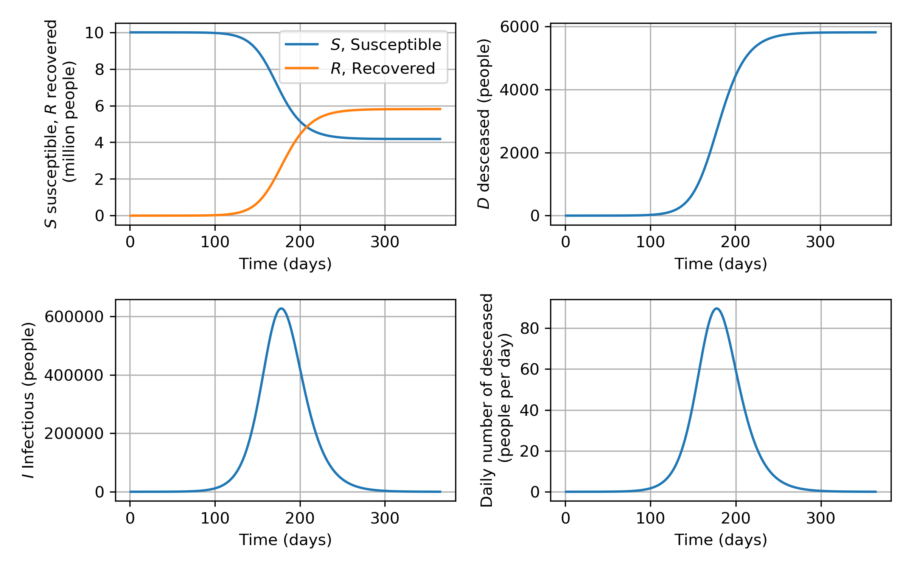

---
header-includes:
        - \usepackage[left=1.9cm, right=1.9cm, top=1.5cm, bottom=1.9cm]{geometry}
---


Exam for the course DAT171 Object oriented programming in Python
===========

**Time:** 9Th June 2020 8:30-13:30

**Teachers:** Thomas Svedberg (031-772 1522), Mikael Öhman (073-6837674), Hugo Strand (031-772 1112)

**Permitted aids:** Cay Horstmann: Python for everyone. Manuals and lecture notes are available in Canvas.

Handing in the code should be done in the correct assignment in Canvas for each task, when you are finished. If you do not upload the files here, they are not included in the exam!

*Make sure you only hand in one solution for each question, otherwise you will receive **zero** points.*
Complex sections of your code should have a descriptive comment of what is achieved.

**Corrections:** The results will be announced through Ladok, on or before June 18Th.
The review will be the same day (June 18Th) 10:00-11:00 through Zoom.

**Grading:**
There is a total of 25 points which yields grades at the standard 40%, 60%, and 80% limits:
```python
def grade(points):
    if points >= 20:
        return 'Grade 5'
    elif points >= 15:
        return 'Grade 4'
    elif points >= 10:
        return 'Grade 3'
    else:
        return 'Fail'
```

\newpage

# Question 1: Top words in English (5p)

You are interested in classical English literature and would like to know what words are most frequency used in written English. To test this you have chosen the good old classic "A Journal of the Plague Year" by Daniel Defoe (published in 1722 and now in public domain). You can find the plain text version of the book in the file: `A_Journal_of_the_Plauge_Year.txt`.

Part A (1p)
-----------

**Task:** Open the file and iterate over each line of the file. For every line, count the number of words per line. Use this to count the total number of words in the book and print the result.

Part B (2p)
-----------

**Task:** Extend your program to analyse the word content of the text. For each line of the file iterate over all words in the line and, use a dictionary to accumulate the number of occurrences of all unique words in the book. Write a separate function `filter_word(word)` that converts all letters in the word to lowercase, removes any trailing separation characters, and returns the result. Use this function to "filter" the word before accumulating to the dictionary.

**Hint:** *The filter function is needed since only splitting on white-space using the string method `.split()` can cause, e.g. "`today`" and "`today.`" to be counted as two different words. To avid this, make sure to strip away special characters, like "`.,!?;:`" in the `filter_word` function.*

Part C (0.5p)
-------------

Use the dictionary to count the number of unique words in the book and print the result. 

Part D (1.5p)
-------------

**Task:** Print a nicely formatted table with the 10 most frequent words in descending order showing, the word, the number of occurrences of the word, and the relative probability of the word (when selecting a word at random from the book).

**Hint:** *When sorting the data in the dictionary the `sorted` function from the Python standard library is useful. For example to sort a dictionary `d` on its keys one can use `s = sorted(d.items(), key=lambda item: item[0])` where `s` becomes a sorted list of tuples with key, value pairs. Please note that the sorting criteria might have to be modified to be applicable here.*

Here is an example output from the full program. Note that the exact number of unique words might vary slightly depending on how you filter special characters.

```
Total number of words: 94887
Total number of unique words: 6555

 word | occurences | probability
------+------------+-------------
 the  |       6099 |        6.4%
 and  |       3897 |        4.1%
 of   |       3168 |        3.3%
 to   |       2903 |        3.1%
 in   |       1885 |        2.0%
 that |       1861 |        2.0%
 was  |       1417 |        1.5%
 it   |       1414 |        1.5%
 a    |       1347 |        1.4%
 as   |       1325 |        1.4%
```

\newpage

# Question 2: The SIRD-Model for epidemic outbreaks (6p)

The Susceptible-Infectious-Recovered-Deceased-Model (SIRDM) is a simplified model for the time evolution of an epidemic outbreak. The model contains four variables, the number of susceptible people $S$, the number of infectious people $I$, the number of recovered people $R$, and the number of deceased people $D$. All variables are considered to be functions of time $t$.

The time evolution of the model variables $S(t)$, $I(t)$, $R(t)$, and $D(t)$, is governed by the coupled first order differential equation system:
$$
\frac{dS}{dt} = - \beta \frac{I S}{N}
\, , \quad
\frac{dI}{dt} = \beta \frac{I S}{N} - \gamma I - \mu I
\, , \quad
\frac{dR}{dt} = \gamma I
\, , \quad
\frac{dD}{dt} = \mu I
$$
where $\beta$, $\gamma$, $\mu$ are the rates of infection, recovery, and mortality, respectively.

You would like to use the SIRD-Model to investigate a (very simplified) scenario for the Swedish Covid-19 epidemic. To do this you would like to use the linear differential equation system solver in SciPy `odeint` in the submodule `scipy.integrate`.

Part A (1p)
-----------

In order to use `odeint` one has to supply a (vector valued) function that returns the first order derivative. For the SIRD-Model this means we have to define a vector $\mathbf{y}$ as, $\mathbf{y} = [ S, I, R, D ]$ and implement a function taking $\mathbf{y}$, $t$, $\beta$, $\gamma$, $\mu$, and $N$ as parameters, that returns the time derivative 
$$
\frac{d\mathbf{y}}{dt} \equiv 
\left[
\frac{dS}{dt},
\frac{dI}{dt},
\frac{dR}{dt},
\frac{dD}{dt}
\right]
\, ,
$$
were the time derivatives are computed using the equations above.

**Task:** Given the skeleton for the function `derivative` below, replace "`...`" with an implementation of the right hand side of the equations for the time derivatives above.
```
def derivative(y, t, beta, gamma, mu, N):
    S, I, R, D = y
    ...
	dy_dt = [dS_dt, dI_dt, dR_dt, dD_dt]
	return dy_dt
```
Part B (2p)
-----------

In order for the simulation to mimic the Covid-19 outbreak in Sweden we have to supply the model parameters. 

There fore we assume that:

* the population size $N$ is ten million people, $N = 10'000'000$ people. 

* the length of convalescence is 7 days,
  which corresponds to a rate of recovery of $\gamma = 1/7$ persons per day. 

* There is, as of today, no established value for the mortality rate $\mu$. The total mortality is believed to be of the order $0.1\%$ which corresponds to a rate $\mu = 0.001 \gamma$ per day, i.e. $\mu = 0.001 / 7$ persons per day.

The rate of infection $\beta$ is together with the recovery rate $\gamma$ related to the so called reproduction number $R$, $R \equiv \beta / \gamma$. An $R$ number above 1 implies that every sick person infects more than one other person causing the epidemic to grow, while an $R$ number below 1 causes the epidemic to die out.

* Assume that social distancing pushes the reproduction number down to $R = 1.5$. This corresponds to an infection rate $\beta = \gamma R = 1.5/7$ persons per day.

Apart from the model parameters we also have to supply the initial condition $\mathbf{y}(t=0)$, for the variables of the model in order to solve for the time evolution. 

* Assume that, at time $t=0$, the number of persons in the four different population groups are, $S=N$, $I = 10$, $R = 0$, $D = 0$, i.e. the whole population is susceptible and that are 10 infectious people in the population.

\newpage

**Task:** Write a Python script that specifies the model parameters $\beta$, $\gamma$, and $\mu$, and the initial condition $S(t=0)$, $I(t=0)$, $R(t=0)$, and $D(t=0)$. Combine this with your implementation of the `derivative` function and the `odeint` function from SciPy and solve for the time evolution of $S(t)$, $I(t)$, $R(t)$, and $D(t)$ during a whole year (365 days), using days as the unit of time.

Part C (1p)
------------

**Task:** Use the vector of the number of deceased $D(t)$ to compute the number of deaths per day.

**Hint:** *The NumPy function `np.diff` can be used.*

Part D (2p)
------------

Use Matplotlib to make a plot of the time evolution in your simulation. Please make four separate subplots, one showing $S(t)$ and $R(t)$, one showing $I(t)$ one showing $D(t)$ and one showing the change in $D(t)$ per day. Please add descriptive axis labels including units, see Fig. 1 for an example plot.

{ width=95% }

\newpage

# Question 3: Basic classes for genealogy (7p)

You have decided to pic up on finding your roots and wants to create your own tool for keeping track of
persons and their (biological) connections.
The first step is to create a class representing a Person and a Family.

Part A (1p)
-------------
**Task:**  Create the class `Person` that stores basic information for a person. The constructor for this class must take the arguments `firstname`, `lastname`,  `born` (year).

Optionally a fourth argument `dead` can be given, default should be `None`.
Here the first two must be of type `str` and the other of type `date` from the library `datetime`.

Part B (1.5p)
-------------
To simplify later parts of your application you decide to store the information on family connections in the `Person` object.

**Task:** Add the following methods (and corresponding data) to the class:

   `add_parent(parent: Person)`

   `add_child (child: Person)`

   `set_spouse(spouse: Person)`


Part C (1p)
-----------
**Task:** Add methods to print and display a `Person` object. One method must make it possible to give a shorter (one line) output when printing a `Person` object (`print(person)`).

In addition a second method `show()` should be implemented.

Examples of expected output can be seen in the examples at the end of this task


Part D (1.5p)
-----------
**Task:** Create the basic `Family` class. Its constructor should have the constructor:

`Family(parent1: Person, parent2: Person = None)`

**Task:** Add the method `add_child(child: Person)`

Both methods should modify the involved `Person` objects in order to reflect the person connections correctly.

Part E (1p)
-----------
**Task:** Add a method `count_descendants` to `Person` that recursively counts a persons descendants and returns this number.

Part E (1p)
-----------
**Task:** Add the exception class `InvalidPerson` and use it in the classes above to make sure that:

* A person only occurs once in a family, and only once as a child for the same person
* A child is strictly younger than its parents


See next page for examples!

\newpage

**Example code:**
```python
p1 = Person("Glenn", "Svensson", date(1990, 10, 21))
p2 = Person("Ada", "Andersson", date(1992, 5, 11))
p3 = Person("Lotta", "Svensson", date(2013, 9, 17))
p4 = Person("Knut", "Andersson", date(2015, 8, 29))

p5 = Person("Lovisa", "Eriksson", date(1927, 7, 3), date(2003, 2, 9))

print(p1, p2, sep=", ")
print(p3, p4, sep=", ")

f1 = Family(p5)
f1.add_child(p2)

f2 = Family(p2, p1)
f2.add_child(p3)
f2.add_child(p4)

p1.show()
p3.show()

print(p5, "Descendants:", p5.count_descendants())
```

**Example output:**
```python
Glenn Svensson (1990-10-21), Ada Andersson (1992-05-11)
Lotta Svensson (2013-09-17), Knut Andersson (2015-08-29)
Glenn Svensson (1990-10-21)
 Spouse: Ada Andersson (1992-05-11)
 Children: Lotta Svensson (2013-09-17), Knut Andersson (2015-08-29)
Lotta Svensson (2013-09-17)
 Parents: Glenn Svensson (1990-10-21), Ada Andersson (1992-05-11)
Lovisa Eriksson (1927-07-03 - 2003-02-09) Descendants: 3
 ```

\newpage

# Question 4: Class hierarchy for cryptos (7p)

In this class we will implement a class hierarchy for different types of cryptos in order to allow encryption and decryption of secret messages.
Real cryptography is difficult, so in these examples we will stick to very simple cryptos (that would be easily cracked in practice). Please see example usages at end.

Part A (1p)
-----------

**Task:** Implement a base-class `Crypto` with the abstract methods `encrypt` and `decrypt` which takes a message and returns the encrypted or decrypted message respectively.

Part B (2p)
-----------

The "pirate language" is a toy encryption game where every consonant (spelling matters, not pronunciation) is doubled, and the letter "o" is inserted in-between.
Vowels are left intact. E.g. the word `Python` becomes `Popytothohnon`.

**Task:** Implement the sub-class `PirateLanguage` that encrypts and decrypts text according to the rules above.
It should preserve capitalisation of words (see example).

**Hint:** *`str.replace` is very useful. Capitalisation is easy to preserve if you replace upper and lower case in the right order.*

Part C (1p)
-----------

Many cryptos does a 1-to-1 replacement of characters. We can save ourselves from having to duplicate code by adding another abstract class.

**Task:** Implement an abstract sub-class `CharacterCrypto` which introduces two new abstract methods: `encrypt_char` and `decrypt_char`, which takes and returns a single character.
Implement `encrypt` and `decrypt` using these character based methods.

**Hint:** *`str.join` is very useful.*

Part D (2p)
-----------

Rotating characters around the alphabet is probably the earliest and simplest crypto. E.g. using the offset 13, the character *a* is replaced with *n*, and *v* loops around and is replaced with *i*.

*Note: We will only consider English alphabet here: abcdefghijklmnopqrstuvwxyz*

**Task:** Implement a sub-class to `CharacterCrypto` called `Rotator`.

* It should take an integer input argument `offset` which determines how much the characters should be shifted.
* Add a **static** helper method `shift` that takes a character and an offset, and shift/rotates it accordingly. If it's not an English letter, just return the character as is. Preserve capitalisation.
* Use your `shift` method to implement `encrypt_char` and `decrypt_char`.

Part E (1p)
-----------

Another simple crypto is to simply replace a character with another.

**Task:** Implement a sub-class to `CharacterCrypto` called `Replacer`.

* It should take a dictionary as input that maps characters to their replacements. The constructor should also store the inverted dictionary so that it can easily and efficiently decrypt messages as well.
  Letters not present in the replacement dictionary should just be left as they are. 

\newpage

Examples
--------

```python
message = 'Robber Bob robs ten banks'
print('Original message:',  message)

# Part B
pcrypto = PirateLanguage()
psecret = pcrypto.encode(message)
print('Pirate encrypted:', psecret)
assert pcrypto.decode(psecret) == message # Decoding should give us back the original message

# Part C
# Check shift helper works correctly
assert Rotator.shift('a', 1) == 'b' # a+1 should become b
assert Rotator.shift('a', -1) == 'z' # a-1 should become z
assert Rotator.shift('g', 13) == 't' # g+13 should become t
assert Rotator.shift(' ', 13) == ' ' # characters not present in the english alphabet are not replaced.

rotcrypto = Rotator(13)
rotsecret = rotcrypto.encode(message)
print('Rotate encrypted:', rotsecret)
assert rotcrypto.decode(rotsecret) == message # Decoding should give us back the original message

# Part D
repcrypto = Replacer({x:y for x,y in zip('abcdefghijklmnopqrstuvwxyz', 'kfghiwxucdyzlmveqabpnojrst')})
repsecret = repcrypto.encode(message)
print('Replace encrypted:', repsecret)
assert repcrypto.decode(repsecret) == message # Decoding should give us back the original message
```

**Output:**
```text
Original message: Robber Bob robs ten banks
Pirate encrypted: Rorobobboberor Bobobob rorobobsos totenon bobanonkoksos
Rotate encrypted: Eboore Obo ebof gra onaxf
Replace encrypted: Avffia Fvf avfb pim fkmyb
```

