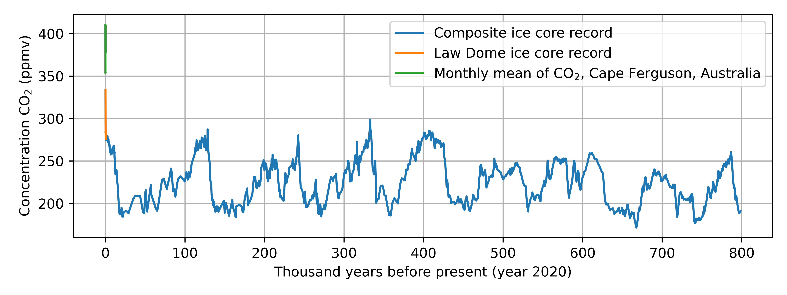
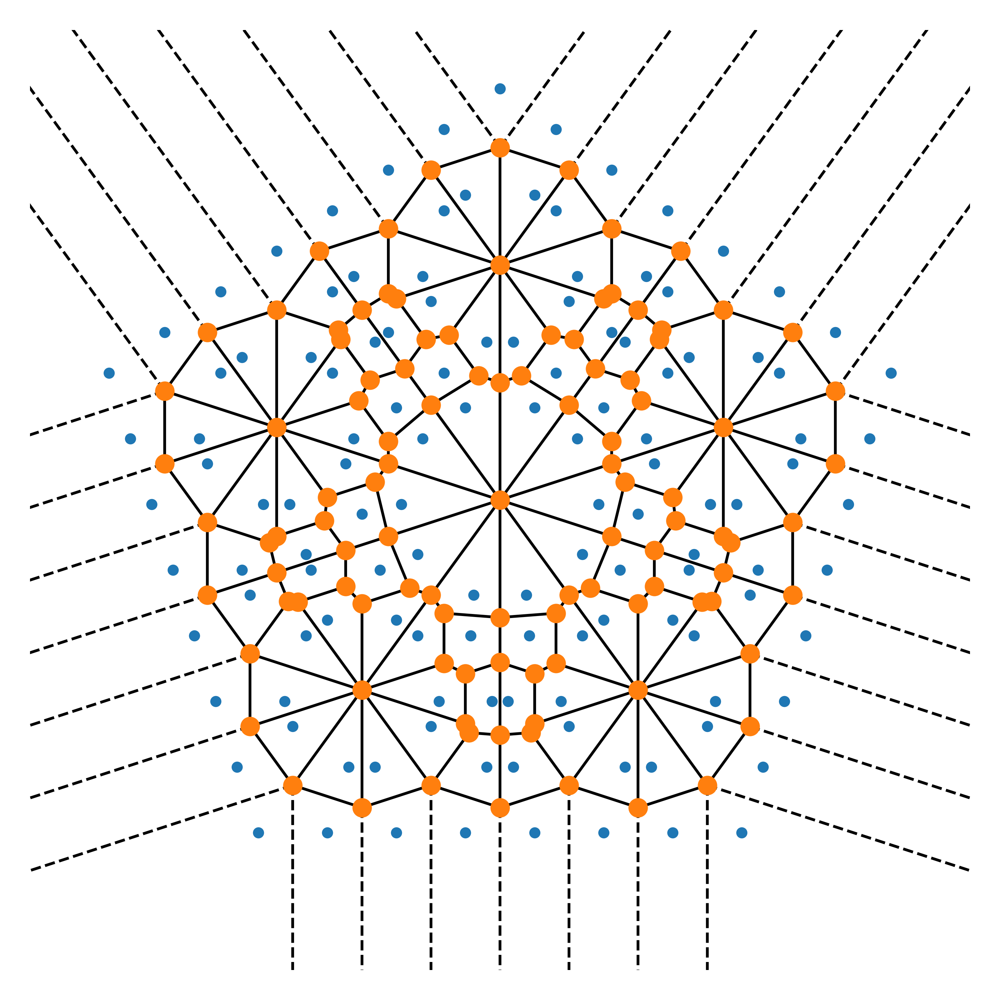

---
header-includes:
        - \usepackage[left=1.9cm, right=1.9cm, top=1.5cm, bottom=1.9cm]{geometry}
---


Exam for the course DAT171 Object oriented programming in Python
===========

**Time:** 9th June 2020 8:30-13:30

**Teachers:** Thomas Svedberg (031-772 1522), Mikael Öhman (073-6837674), Hugo Strand (031-772 1112)

**Permitted aids:** Cay Horstmann: Python for everyone. Manuals and lecture notes are available in Canvas.

Handing in the code should be done in the correct assignment in Canvas for each task, when you are finished. If you do not upload the files here, they are not included in the exam!

*Make sure you only hand in one solution for each question, otherwise you will receive **zero** points.*
Complex sections of your code should have a descriptive comment of what is achieved.

**Corrections:** The results will be announced through Ladok, on or before June 18th.
The review will be the same day (June 18th) 10:00-11:00 through Zoom.

**Grading:**
There is a total of 25 points which yields grades at the standard 40%, 60%, and 80% limits:
```python
def grade(points):
    if points >= 20:
        return 'Grade 5'
    elif points >= 15:
        return 'Grade 4'
    elif points >= 10:
        return 'Grade 3'
    else:
        return 'Fail'
```

\newpage

# Question 1: Carbon dioxide time series (5p)

The concentration of carbon dioxide (C0$_2$) in the atomosphere is known to be an important factor determining the magnitude of the anthropogenic greenhose effect. You are preparing a presentation on the topic and would like to make a plot showing the evolution of the atmospheric CO$_2$ concentration as a function of time using already published results. Your colleauge has sent you the three text files: `edc-co2-2008.txt`, `lawdome.combined.dat`,  and `cfa_02D0_mm.co2`, containing the relevant time series data. Your task is to use Python, Numpy, and Matplotlib to automatically read the three files, filter out the relevant data, and plot the three datasets together in one figure. 

Please note that the data has to be parsed from the original files, i.e. the files are not to be modified in any way.

Part A (1p)
-----------

**Task:** Read the composite CO$_2$ record in the file `edc-co2-2008.txt` into two Numpy arrays `edc_age` and `edc_co2_ppmv` containing the age of the measurements and the CO$_2$ concentrations, respectively.

Part B (1p)
-----------

**Task:** Read the data from the file `lawdome.combined.dat` into two Numpy arrays `law_age` and `law_co2_ppmv` containing the age of the air and the CO$_2$ concentrations, respectively.

Make sure that the data is sorted on age.

Part C (1p)
-------------

**Task:** Read the data from the file `cfa_02D0_mm.co2` into two Numpy arrays `au_age` and `au_co2_ppmv` containing the time of the measurements and the CO$_2$ concentrations, respectively.

Make sure to remove invalid data points (where the CO$_2$ concentration is set to -999.0).

Part D (2p)
-------------

**Task:** Make a plot showing the three data-sets with the CO$_2$ concentration in the unit parts per million by volume (ppmv) on the y-axis and the unit thousand years since present on the x-axis. Ensure to annotate the figure with x- and y-labels including units, and use a legend to make the three data sets individually identifiable.

For an example plot see Fig. 1.

{ width=95% }

\newpage

# Question 2: Complex art and Voronoi diagrams (6p)

To any set of points in the two dimensional plane the Voronoi partition is a set of equally many polygons, where every polygon covers the area which closest to one particular point compared to the other points in the set. In SciPy there are utilities for constructing the Voronoi polygons and for visualizing them, given a set of point coordinates in the plane.

You would like to use this functionality to generate interesting geometrical figures. In order to do this you first need to write a program that generates an interesting set of points in the plane.

Your lecturer in math (who likes complex numbers) propose the follwing iterative formula:

1. Start with an array $A$ containing the complex number $0.$, $A = [0.]$ and $r=1/2$.
2. For each complex number $z$ in $A$ 
   a. generate $N_p$ new points $z_n$, $0 \le n < N_p$ using the formula
      $$ z_n = z + i r e^{i n \theta} $$
      where $r$ is a given radius, the rotation angle $\theta$ is $\theta = 2\pi / N_p$, 
	  and $i$ is the imaginary number ($i \equiv \sqrt{-1}$).
   b. Replace $z$ in $A$ with the numbers $z_n$
3. Scale the radius $r$ with a factor $1/2$, $r := r/2$
4. Iterate $N_{iter}$ times from point 2.
5. Get the $x$ and $y$ coordinates as the real and imaginary part of the complex numbers $z$ in $A$
   $x = \text{Re}[z]$, $y = \text{Im}[z]$.

Part A (2p)
-----------

**Task:** Implement the operations in step 2 above in the function
```python
def new_rotated_points(A, N_p, r):
   ...
   return A_new
```
that takes an (Numpy) array of points `A`, the number of new points to generate (per input point) `N_p`, the radius `r` (as a float), and returns an array `A_new` with the new points.

**Test** Your implementation of `new_rotated_points` should produce the output:
```text
N_p = 2 : A = [ 0.00+0.50j -0.00-0.50j]
N_p = 4 : A = [ 0.00+0.50j -0.50+0.00j -0.00-0.50j  0.50-0.00j]
N_p = 6 : A = [ 0.00+0.50j -0.43+0.25j -0.43-0.25j -0.00-0.50j  0.43-0.25j  0.43+0.25j]
```
when called by the test code:
```python
np.set_printoptions(precision=2, floatmode='fixed', suppress=True, linewidth=1000)
for N_p in [2, 4, 6]:
    A = new_rotated_points(np.array([0.]), N_p=N_p, r=0.5)
    print(f'N_p = {N_p} : A = {A}')
```

Part B (2p)
-----------

**Task:** implement the steps 1 to 5 above in the function
```python
def generate_point_set(N_p=5, N_iter=3, r=0.5):
   ...
   return x, y
```
that takes the number of new points to generate `N_p` (per iteration), the number of iteration `N_iter` and the initial radius `r` and returns two arrays `x` and `y` with the x- and y-coordinates of the generated points.

**Test:** Check that your implementation produces the result
```
[ 0.00 -0.50 -0.00  0.50 -1.00 -1.50 -1.00 -0.50 -0.00 -0.50 -0.00  0.50  1.00  0.50  1.00  1.50]
[ 1.50  1.00  0.50  1.00  0.50  0.00 -0.50 -0.00 -0.50 -1.00 -1.50 -1.00  0.50 -0.00 -0.50 -0.00]
```
when called with
```python
print('{0}\n{1}'.format(*make_points(N_p=4, N_iter=2, r=0.5)))
```

Part C (2p)
-----------

Combine your point set generator with the Voronoi diagram builder and plotter from SciPy (see `scipy.spatial.Voronoi` and `scipy.spatial.voronoi_plot_2d`) and write code that reproduces the plot in Fig. 2 generated from the pointset with `N_p=5`, `N_iter=3`, `r=0.5`.

{ width=100% }

\newpage

# Question 3: ... (Xp)

Part A (Xp)
-----------

**Task:** TBD.

\newpage

# Question 4

You must solve this problem without using `numpy` or `scipy`.

Sometimes we need to create very large arrays in memory constrained environments.
One common trick that is sometimes applicable is to lazily evaluate the contents of the array, as it is accessed.
The point of these as that they don't allocate memory up front. 

## Part A

Write a base class `GeneratorVector` that stores the length of the array and provide the `len(v)` operation.

1. It should enforce the `__getitem__` method as abstract.
2. It should implement the method `collect()` which collects all of the vector and return a normal `list`.

## Part B

Implement a subclass `ConstantVector` which represents a vector with constant values.
The constructor should take a constant and the length as input.

1. Add support for `repr()`
2. Add support for multication with a scalar, e.g. `const_vec * 2` which should return a new `ConstantVector`.
3. Add support for addition with a scalar, e.g. `const_vec + 3.14` which should return a new `ConstantVector`.

## Part C

Implement a subclass `LinspaceVector` which represents a vector with linear increments from a start to an end value in a given number of steps.
The constructor should take `start`, `end`, and `steps` as input.

1. Add support for `repr()`
2. Add support for multication with a scalar, e.g. `linsp_vec * 2` which should return a new `LinspaceVector`.
3. Add support for addition with a scalar, e.g. `linsp_vec + 3.14` which should return a new `LinspaceVector`.

## Part D

Implement a subclass `FunctionVector` which represents a vector with values defined by a function evaluated at the index: $v_i = f(i)$.
The constructor should take function handle and a vector length as input.

1. Add support for `repr()`
2. Add support for multication with a scalar, e.g. `linsp_vec * 2` which should return a new `FunctionVector`.
3. Add support for addition with a scalar, e.g. `linsp_vec + 3.14` which should return a new `FunctionVector`.

*Hint: You can use lambdas to construct new functions when multiplying and adding.*

## Test


