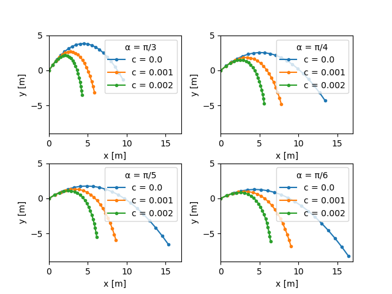

---
header-includes:
        - \usepackage[left=1.9cm, right=1.9cm, top=1.5cm, bottom=1.9cm]{geometry}
---


Exam for the course DAT171 Object oriented programming in Python
===========

**Time:** 16th March 2021 8:30-13:30

**Teachers:** Thomas Svedberg (031-772 1522), Mikael Öhman (073-6837674)

**Permitted aids:** Cay Horstmann: Python for everyone. Manuals and lecture notes are available in Canvas. As per general instructions, all aids permitted for online exams. However, it is not permitted to cooperate with or take help from another person.

Handing in the code should be done in the correct assignment in Canvas for each task, when you are finished. If you do not upload the files here, they are not included in the exam!

*Make sure you only hand in one solution for each question, otherwise you will receive **zero** points.*
Complex sections of your code should have a descriptive comment of what is achieved.

**Corrections:** The results will be announced through Ladok, on or before April 2st.
The review will be the same day (April 1st) 10:00-11:00 through Zoom.

**Grading:**
There is a total of 25 points which yields grades at the standard 40%, 60%, and 80% limits:
```python
def grade(points):
    if points >= 20:
        return 'Grade 5'
    elif points >= 15:
        return 'Grade 4'
    elif points >= 10:
        return 'Grade 3'
    else:
        return 'Fail'
```

\newpage

# Question 1 (7p)

A DNA sequence is a list of nucleotides where each nucleotide can be of four variants, denoted
A, G, T, or C. The file `gene_data.dat` contains sets of such DNA sequences.
The data is structured as follows:
- Lines starting with `#` are comments and can be ignored.
- Before a DNA sequence start, the name of the sequence is denoted with a `%` and then the name, for example `% Monkey`.
- The DNA sequence can contain the characters `A`, `G`, `T`, `C` or `*`, where `*` is considered a "wildcard" (could be any of the nucleotides).
- There is an empty line before the next DNA sequence entry occurs.

## Part A, parsing (3p) 
- A.1: Create the function `parse_nucleotides(file: str)` that takes a filename and returns a dictionary with the
 name of the sequence as the keys and a list of the nucleotides as the values. The nucleotide list should contain
  strings of length 1, for example `['A', '*', 'G']`.

If you do not manage to complete Part A, you can use the following Python code to generate
data that you can then use in Part B and Part C.

```python
data = {
  "dog" : ['A', 'A', 'G', 'C', 'T', '*']*10,
  "cat" : ['A', '*', 'T', 'T']*5,
  "fish" : ['A', 'A', 'G', 'G']*3,
}
```

## Part B, analysis (2p)
- B.1: Create a function `count_nucleotides(dna)` that takes a list of nucleotides and counts the max number of each nucleotide in the sequence.
  A wildcard can count as any of the nucleotides, for example, the sequence `A*AG` could have max 3 A and max 2 G nucleotides.
  For example, using the help data given in Part A:
  ```python
  >>> count_nucleotides[data["dog"]]
  (30, 20, 20, 20) # given in the order A, G, T, C
  ```
- B.2: Create a function `count_max_nucleotides` that calculates for each of the DNA sequences in the file, which one has the highest possible
`A`, `B`, `C`, `D` nucleotides *on average* (divide the possible total with the DNA sequence length).
  ```python
  >>> count_max_nucleotides(data)
  {'A': 'dog', 'G': 'fish', 'C': 'dog', 'T': 'cat'}
  ```
  
## Part C, mRNA printing (2p)
DNA can be converted to mRNA via the nucleotide mapping
`T -> A`, `A -> U`, `G -> C` and `C -> G`. Wildcards map to wildcards (`* -> *`).

- C.1: Create a function `export_to_mRNA(file: str, data: dict)` that writes the `data`
read in Part A in the same format as `gene_data.dat` but with the DNA converted to mRNA via the mapping given above.
 For example, the sequence:
 ```
 % Name
 TAAG
 ```

 should be written as

 ```
 % Name
 AUUC
 ```
 The max length for each line of the mRNA sequence should be 40 (just like in `gene_data.dat`).
- C.2: Check that `parse_nucleotides` can read the file written by `export_to_mRNA`.

\newpage


# Question 2: Projectile motion (5p)

The state of a projectile is described by the state vector $\boldsymbol{s}$ containing its velocity,
$\boldsymbol{v} = [v_x, v_y]$, and position, $\boldsymbol{p} = [p_x, p_y]$:
$$
\boldsymbol{s} = 
\begin{bmatrix}
v_x \\
v_y \\
p_x \\
p_y
\end{bmatrix}
$$
The motion of the projectile is described by the following ordinary differential equation (ODE):
$$
\frac{\mathrm{d}\boldsymbol{s}}{\mathrm{d} t} = 
\begin{bmatrix}
\dot{v}_x \\
\dot{v}_y \\
\dot{p}_x \\
\dot{p}_y
\end{bmatrix} =
\begin{bmatrix}
W_x / m\\
-g + W_y/m\\
v_x \\
v_y
\end{bmatrix}
$$
where $m = 0.1\ \mathrm{kg}$ is the mass of the projectile, and $g=9.82\ \mathrm{kg\ m/s^2}$ the gravitational
acceleration.
$\boldsymbol{W} = [W_x, W_y]$ represent the air resistance, and can be computed as
$$
\boldsymbol{W} = - c\ |\boldsymbol{v}|^2\ \boldsymbol{e}_v,
$$
where $c$ is a model parameter (see below), $|\boldsymbol{v}|$ is the norm of the velocity vector, and $\boldsymbol{e}_v$
is a unit vector in the direction of the velocity, i.e.
$$
\boldsymbol{e}_v = \frac{\boldsymbol{v}}{|\boldsymbol{v}|}.
$$
The initial conditions for the ODE, $\boldsymbol{s}_0$ is parametrized with an angle $\alpha$:
$$
\boldsymbol{s}_0 = 
\begin{bmatrix}
v_{x,0} \\
v_{y,0} \\
p_{x,0} \\
p_{y,0}
\end{bmatrix} = 
\begin{bmatrix}
10 \cos(\alpha) \\
10 \sin(\alpha) \\
0 \\
0
\end{bmatrix}
$$

Part A (2p)
-------------

**Task:** Write a function `time_derivative(s, t, params)` that evaluates and returns the
time derivative of the state vector $\boldsymbol{s}$, i.e. $\mathrm{d}\boldsymbol{s}/\mathrm{d}t$ as described
by the equation above.

Input:

* `s: numpy.ndarray`: the (current) state vector $\boldsymbol{s}$ containing $v_x$, $v_y$, $p_x$ and $p_y$,
* `t: float`: the current time,
* `params`: problem parameters (e.g. the mass, gravitational acceleration, wind resistance parameter `c`).

Output:

* A `numpy.ndarray` containing the 4 elements of $\mathrm{d}\boldsymbol{s}/\mathrm{d}t$.


Part B (1.5p)
-----------

**Task:** Write a function `simulate_projectile(ang, c)` that integrates the ODE, for the specified initial state
$\boldsymbol{s}_0$, for (at least) 20 timesteps between `0` and `T`.
Use `scipy.integrate.odeint` with the `time_derivative` function from Part A.

Input:

* `ang: float`: the angle $\alpha$ for specifying the initial condition $\boldsymbol{s}_0$,
* `c: float`: the model parameter for the wind resistance.

Output:

* A `numpy.ndarray` containing the (integrated) state vectors for each timestep.


Part C (1.5p)
-----------

**Task:** Run the simulation for 4 different angles, $\alpha = [\pi/3, \pi/4, \pi/5, \pi/6]$, and 3 different values of
the wind resistance parameter, $c = [0.0, 0.001, 0.002]$.
Use `matplotlib` to create a plot with 4 subplots (one for each angle $\alpha$). Each subplot should include three lines (one for each $c$)
showing the flight path of the projectile.
Each subplot must have (i) x- and y-labels, and (ii) a legend that makes it clear which line corresponds to which value of `c`.
It must also be clear which subplot corresponds to which initial angle $\alpha$.

An example plot is included below. It is not necessary to copy/replicate this plot exactly, it merely serves as an example of
what is considered to be full points for Part C.



\newpage

# Question 3: A serie of cosine functions (7p)

While writing a mathematical tool for signal processing, we find ourself needing a lot of sums of cosine functions.
The functions are defined as: $f(x) = \sum_i=0^\infty c_i \cos(2\pi\times i \times x)$ where $c$ is coefficients.
In practice, the higher terms tend towards zero, so we in the codes, we limit ourselves to a finite sum, only storing the $N$ first coefficients of $c$, treating all higher terms as zero.

## Part A (1p)
Write a class `CosineSerie` that represents a finite sum of cosine functions as described above.
The constructor should take a list of the first N non-zero coefficients of the series.
Add `repr` support so that it looks nice (similar to example below).

## Part B (1p)
Add support for `iter` and `len` which traverses and gives the number of the coefficients respectively.

## Part C (1p)
Add a method `evaluate_term` which should take an index `i` and a value `x` and return the i'th term of the sum: $c_i \cos(2\pi\times i\times x)$.
Negative indexes should raise an `IndexError`, and all higher order terms should return zero.

## Part D (1p)
Make your `CosineSerie` *callable* so that we can evaluate the series 

```python
f = CosineSerie([3., 2., 1.])
print(f(0.5)) # should equal: 3*cos(2*pi*0*0.5) + 2*cos(2*pi*1*0.5) + 1*cos(2*pi*2*0.5) = 2.0
```

## Part E (1p)
Add support for multiplying a series with a scalar, using both `*` and `*=`. 
This can be easily done by 
$$
s \times f(x) = \sum_i=0^\infty (s\times c_i) \cos(2\pi\times i \times x)
$$

## Part F (2p)
We can also add two series together by simply adding together their coefficients.

$$
(\sum_i=0^\infty c_i \cos(2\pi\times i \times x)\ + (\sum_i=0^\infty d_i \cos(2\pi\times i \times x)\ +
= \sum_i=0^\infty (c_i + d_i) \cos(2\pi\times i \times x)
$$

Introduce a private static method `__add_coefficients` that takes 2 lists and adds them together by padding out the shorter list with zeros (if necessary). E.g. `[1, 2, 3]` and `[1, 1, 1, 1]` should produce `[2, 3, 4, 1]`.

Use this method to implement support for `+` and `+=`.


# \newpage


# Question 4 (8p)

HTML is a markup language used for webpages which allows you to control layout and design.

The general syntax uses an opening `<x>` followed by content followed by a closing `</x>.
Additional data fields can be added to the opening block writing, e.g:
`<a href="www.chalmers.se" style="color:red">a link to chalmers</a>`

Blocks typically contain each other in a hierarchy, meaning one block can contain another.

To model this in code, we shall introduce a hierarchy of classes which are able to generate the HTML text. 

Examples at end show intended output strings when printed.

## Part A (2p)

Introduce an abstract base class `HTMLElement` with an abstract `str` conversion method.
Have the base class store a `style` member variable, with a `None` default value.
Include a convenience method `style_string` that takes no arguments and returns a string: `'style="xxx"'` if the style value is not `None`, or just an empty string `''` if there is no styling.

## Part B (1p)

Add a subclass `Link` that takes an `url` (e.g. `'https://www.chalmers.se'`), an `element` that goes inside the link (typically the link name), and an optional `style` (default value `None`).

The format for the 
```
<a href="put_url_here">put_element_here</a>
<a href="put_url_here" style="if style exists">put_element_here</a>
```

## Part C (3p)

Several simple text-related HTML blocks are very similar, e.g. `<b>bold</b>`, `<i>italic</i>` which can be combined in various ways.

To save ourselves some coding, implement an abstract class `TextElement` which should be a subclass to `HTMLElement`. Introduce the new abstract method `tag_name` which should return the name of the HTML tag (`'b'` for bold, `'i'` for italic) 
Implement the `str` conversion.

Constructing any `TextElement` subclass should take `element` and an optional `style` (default value `None`).
In this application we only wish to allow for the input `element` to be a `str` or `TextElement`, so add a check and raise a `ValueError` if someone tries to use something else e.g. (`Bold(123)`, `Italic(Link(url, name))`).

Implement the now simple `TextElement`-subclasses `BoldText` and `ItalicText`


## Part D (2p)

We need some HTML elements contain multiple other elements.
Create a `Paragraph` and `Body` subclass to `HTMLElement`. They should both take a list of elements, and the optional `style` (default value `None`).

Just join the elements with space seperation when converting the `Paragraph` to a `str` inside a block named `p`:
```
<p>first_element second_element third_element ...</p>
```

For the `Body`, which typically contains many paragraphs, make the output more readable by introducing new lines for each element, and indenting it 4 spaces.

## Test code

```python
p0 = Paragraph(["Text can be", ItalicText("cursive,"), BoldText("bold"), "or", ItalicText(BoldText("both"), style="color:red")])
print("first paragraph as HTML:")
print(p0)
print()
p1 = Paragraph(["Chalmers", Link('https://www.chalmers.se', "link", 'color:blue')])
print("second paragraph as HTML:")
print(p1)
print()
body = Body([p0, p1])
print("whole body as HTML:")
print(body)
```

Output:
```html
first paragraph as HTML:
<p>Text can be <i>cursive,</i> <b>bold</b> or <i style="color:red"><b>both</b></i></p>

second paragraph as HTML:
<p>Chalmers <a href="https://www.chalmers.se" style="color:blue">link</a></p>

whole body as HTML:
<body>
    <p>Text can be <i>cursive,</i> <b>bold</b> or <i style="color:red"><b>both</b></i></p>
    <p>Chalmers <a href="https://www.chalmers.se" style="color:blue">link</a></p>
</body>
```

