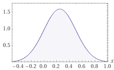
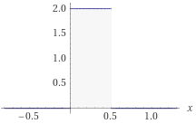

---
header-includes:
        - \usepackage[left=1.9cm, right=1.9cm, top=1.5cm, bottom=1.9cm]{geometry}
---


Exam for the course DAT171 Object-oriented programming in Python
===========

**Time:** 9th June 2021 8:30-13:30

**Teachers:** Thomas Svedberg (031-772 1522), Mikael Öhman (073-6837674)

**Permitted aids:** Cay Horstmann: Python for everyone. Manuals and lecture notes are available in Canvas. As per general instructions, all aids are permitted for online exams. However, it is not permitted to cooperate with or take help from another person.

Handing in the code should be done in the correct assignment in Canvas for each task when you are finished. If you do not upload the files here, they are not included in the exam!

*Make sure you only hand in one solution for each question, otherwise you will receive **zero** points.*
Complex sections of your code should have a descriptive comment of what is achieved.

**Corrections:** The results will be announced through Canvas, on or before June 16th.
The review will be on the same day (June 16) 10:00-11:00 through Zoom.

**Grading:**
There is a total of 25 points which yields grades at the standard 40%, 60%, and 80% limits:
```python
def grade(points):
    if points >= 20:
        return 'Grade 5'
    elif points >= 15:
        return 'Grade 4'
    elif points >= 10:
        return 'Grade 3'
    else:
        return 'Fail'
```

\newpage

# Question 1: SCB data files (7p)

You have received a number of data files from SCB (Statistics Sweden https://www.scb.se/en/) and want to make a small program to
read, process and display information from these.

The files all have the same basic format, a varying number of words (call this the _label_ here), followed by a period field (on the format yyyyMmm, ex. "2021M03") and finally a field with a value.

**Note:** ".." in the value field indicates no available data!

See the example file `test-data.txt` that can be used for development / debugging, and the "real" file to be used `Energy.txt`. 


Part A (2p)
-------------

**Task:** Write a function `read_data(filename: str)` that can parse files like the ones above and returns

1. a dictionary with all the data and the period as key
2. a dictionary with all the data and the label* as key

* Let the label be everything but the period and value fields from the files.

Part B (1p)
-----------

**Task:** Write a function `compute_total(data: dict)` that takes one of the dictionaries generated above and computes and _adds_ the field "total".

I.e. for the test data and the dict with period as key, `data["2020M01"]["total"]` will be `878`.


Part C (1p)
-----------

**Task:** Write a function `sum_for_year(data: dict)` that takes the dictionary with period as the key above and creates and returns a _new_ dictionary where the year is the key and data is summarised over the periods of the year.


Part D (1.5p)
-------------

**Task:** Write a function that takes the dictionary with the label as key and prints a summary table, see below.

* The heading for the labels can be a fixed variable in your code.
* The unit for data can be fixed variable in your code. 
* The width of the label-field must __not__ be a constant, it must be determined by your code. I.e. you should not need to modify the code here when switching between the two files provided.

```
Produktionsslag                                                    GWh
----------------------------------------------------------------------
vattenkraft (inkl pumpkraft), netto                          3046002.0
vindkraft                                                     163460.0
kärnkraft (kondens), netto                                  2563225.0
konventionell värmekraft, netto                              519311.0
mottryck, industriellt                                        202418.0
mottryck, kraftvärmeverk                                     241528.0
konventionell värmekraft, kondensproduktion                   59539.0
konventionell värmekraft, gasturbin- och annan produktion      2592.0
import                                                        473801.0
```

Part E (1.5p)
-------------

**Task:** Write a function that takes the dictionary with the year as key and prints the full table, see below.

* The unit for data can be fixed variable in your code. 
* The width of the label-field must __not__ be a constant, it must be determined by your code. I.e. you should not need to modify the code here when switching between the to files provided.

First few columns of output:
```
 GWh                                                          1974     1975     1976
------------------------------------------------------------------------------------
import                                                      6681.0   6313.0   7868.0
konventionell värmekraft, gasturbin- och annan produktion     35.0    121.0    124.0
konventionell värmekraft, kondensproduktion                 8076.0   3485.0   7328.0
konventionell värmekraft, netto                            14953.0  10195.0  14681.0
kärnkraft (kondens), netto                                  1902.0  11429.0  15240.0
mottryck, industriellt                                           0        0   3337.0
mottryck, kraftvärmeverk                                         0        0   3892.0
vattenkraft (inkl pumpkraft), netto                        56623.0  56978.0  54166.0
vindkraft                                                        0        0        0
------------------------------------------------------------------------------------
 TOTAL                                                     88270.0  88521.0 106636.0
```

# Question 2 Pollutants (5p)

You want to analyse and visualise pollutants in Sweden and have prepared a file "pollutants.txt" with the data.
To simplify the task here, you can use the stub file "question2_stub.py" to read the data and set up the headers/labels for it.

After reading and reformatting the data, it is in the format of a 3-dimensional NumPy array with the shape (26, 11, 30).
There are 30 years, 26 pollutants and 11 sectors corresponding to these data columns/rows/etc. These can be seen from the headings/labels set up by the stub file.

**Note!** You may _not_ use any loops when calculating the required data below; or for plotting individual data points. Loops may however be used when looping
over the headers/labels and units.

Part A (0.5p)
-------------

**Task:** Create a new NumPy array with the sum of pollutants over the sectors. Remember, no loops!

Part B (2p)
-----------
**Task:** In the top row of a 3 column, 2 row plot, using the data from task A, plot the pollutants with unit **t**, **kg** and **g** in separate plots with the year as x-axis.

Hint: The legend should show name of pollutants for part B.

Part C (2.5p)
-------------
**Task:** In the bottom row, plot the sum of pollutants from each sector with unit **t**, **kg** and **g** separate plots with the year as x-axis.

Hint: The legend should show name of sectors for part C.

For full points in part B and C, the plots must include (correct) labels for x-axis, y-axis and a legend.


# Question 3 (6p)

\newpage
# Question 4 (7p)

Probability distributions come in many common variants, and can be modelled by a simple class hierarchy.
The distributions all have shared properties we wish to model here:
1. The integral under the area is always 1 (total probability)
2. They can be shifted by a given offset on the `x`-axis
3. One can compute random numbers based on the distribution

You may **not** import anything from `scipy` in your solution to this question.

Part A (2p)
-----------

Create an abstract base class `Distribution` that stores an `offset` value.
1. Force all subclasses to be *callable* by marking the `__call__` method abstract. It should take the scalar `x` as input and compute the probability density function for each respective distribution.
2. Introduce the abstract method `random` which takes no arguments and just returns a random value according to the distribution.
3. Implement the method `integrate` which takes a `start` and `end` value and computes the integral of the distribution numerically.
   You can use ~100 steps for your numerical integration and we consider it sufficiently accurate.

*Hint: The trapezoidal rule makes numerical integration simple. You may choose to use `linspace` and `trapz` from `numpy` if you want.*

Part B (1.5p)
-----------

Add a subclass `NormalDistribution` whose constructor takes a standard deviation $\sigma$ and an `offset` (often noted $\mu$ for normal distributions).
Add `repr` support.

The probability density function for a normal distribution is
$$
f(x) = \frac{1}{\sigma\sqrt{2\pi}} e^{-\frac{1}{2} \left(\frac{x-\mu}{\sigma}\right)^2}
$$
where $\mu$ is our offset (which is the mean value of the distribution).

Use the `numpy.random.normal` function to implement your `random` method for this class.


Part C (1.5p)
-----------

Add another subclass `UniformDistribution` whose constructor takes a `width` and an `offset`.
Add `repr` support.

The probability density function is a constant value 
A uniform distribution takes a constant value within the interval specified by the `width` and `offset`, and is zero outside the range.
$$
f(x) = \begin{cases}\frac{1}{w} &\text{if}\; |x-\mu| \leq \frac12 w \\ 0 & \text{otherwise}\end{cases} 
$$
where $w$ is the `width`.

Use the `numpy.random.uniform` function to implement your `random` method for this class.


Part E (1p)
-----------

Since only strictly positive `sigma` and `width` makes sense here, check this in the constructors for `NormalDistribution` and `UniformDistribution` respectively. Raise a `ValueError` with an informative text if they are $\leq 0$.

Part D (1p)
-----------

We might be unhappy with the accuracy of the numerical integration for functions with jumps like `UniformDistribution`.
Overload the `integrate` method for `UniformDistribution` and implement directly using the `with` and `offset`.

\newpage
## Test code

```python
nd = NormalDistribution(sigma=0.25, offset=0.25)
print(repr(nd))
print(f'nd(0.3) = {nd(0.3)}')
print(f'nd(1.0) = {nd(1.0)}')
print(f'nd.integrate(0., 0.5) = {nd.integrate(0., 0.5)}')
print([nd.random() for _ in range(10)])  # expect numbers near 0 to 0.5
```

**Output:**

```text
NormalDistribution(sigma=0.25, offset=0.25)
nd(0.3) = 1.5641707759018237
nd(1.0) = 0.01772739364775203
nd.integrate(0., 0.5) = -0.19873158396086105
[0.7384150681500825, 0.3010095144949376, 0.12886428126140254, 0.13194780253600646, -0.23110145264199394, 
0.28187785317813113, 0.28094415631117203, 0.09279944391795808, 0.1102525524674976, 0.045867683096291884]
```


Probability density function of `NormalDistribution` above:

{ width=30% }


```python
ud = UniformDistribution(width=0.5, offset=0.25)  # covers the interval 0 to 0.5
print(repr(ud))
print(f'ud(0.3) = {ud(0.3)}')
print(f'ud(1.0) = {ud(1.0)}')
print(f'ud.integrate(0., 0.5) = {ud.integrate(0., 0.5)}')
print([ud.random() for _ in range(10)])  # expect numbers within 0 to 0.5
```

Probability density function of `UniformDistribution` above:

{ width=30% }

**Output:**

```text
UniformDistribution(width=0.5, offset=0.25)
ud(0.3) = 2.0
ud(1.0) = 0
ud.integrate(0., 0.5) = 1.0
[0.45985711363610104, 0.47120478419360423, 0.35649936960094103, 0.028760933366553165, 0.3592645024307155,
0.3740826570968661, 0.3753242826337947, 0.3860549454524408, 0.06137381165067951, 0.31450209950407876]
```
