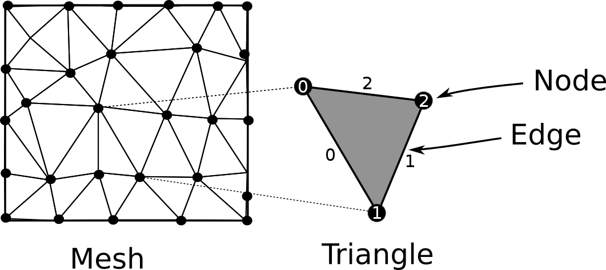

---
header-includes:
        - \usepackage[a4paper,left=1.9cm, right=1.9cm, top=1.5cm, bottom=1.9cm]{geometry}
---


Exam for the course DAT171 Object oriented programming in Python
===========

**Time:** 8th June 2023 8:30-13:30

**Teachers:** Thomas Svedberg (031-772 1522), Mikael Öhman (073-6837674)

**Permitted aids:** Cay Horstmann: Python for everyone. Manuals and lecture notes are available on the computers.

**Teacher will visit the rooms:** Around 10:00 and 12:00

**Formalities**: In each file you hand in, you should write your examination code as well as the computer "number".

The documentation and lectures notes are available on `C:\__EXAM__`. Verify that these files are there immediately.
Handing in the code should be done under the folder: `C:\__EXAM__\Assignments\` when you are finished. If you do
not store the files here, they are not included in the exam. Save the files for each question in the appropriate folder,
e.g. `C:\__EXAM__\Assignments\Question1\`.
*Make sure you only hand in one solution for each question, otherwise you will receive **zero** points.*
Complex sections of your code should have a descriptive comment of what is achieved.

When you finish the exam, you should log out and fill in the (empty) exam cover page like normal and hand this in.

**Corrections:** The results will be announced through Ladok as soon as possible.
The exam review will be on June 15th 12:20-13:00 at Fysikgården 4, 6th floor.

**Grading:**
There is a total of 25 points which yields grades at the standard 40%, 60%, and 80% limits:
```python
def grade(points):
    if points >= 20:
        return 'Grade 5'
    elif points >= 15:
        return 'Grade 4'
    elif points >= 10:
        return 'Grade 3'
    else:
        return 'Fail'
```

\newpage


Question 1: Paragraph formatting (6p total)
===========================================

The goal here is to make a file with text prettier by cutting lines after a given number of columns (characters).

Part A (3p)
----------

Write a function `read_paragraphs` which takes a filename and returns a list of every paragraph (which is stored as a list of words).
New paragraphs are defined by one or more empty lines in the input files, see example `small_inputs.txt`.

Example:
```python
>>> paragraphs = read_paragraphs('small_input.txt')
>>> print(paragraphs)
[['This', 'is', 'an', 'example.', 'This', 'is', 'paragraph', 'one.'],
 ['Now', 'we', 'are', 'onto', 'the', 'second', 'paragraph!'],
 ['Finally,', 'the', 'last', 'paragraph.']
]
```

Each paragraph should be stored as a list of words.

Part B (3p)
----------

Write a function `format_file(paragraphs, output, max_cols=80)` which takes a list of paragraphs and writes the text files according to the rules:

 * Linebreaks should be applied if the content doesn't fit within `max_cols` characters.
 * The first line on every new paragraph should be indented by 4 spaces.

See `example_output.txt` for how it should look (based on `example_input.txt`, and 80 column width).

Use:
```python
>>> paragraphs = read_paragraphs('example_input.txt')
>>> format_file(paragraphs, 'student_output.txt')
```

You do **not** need to hyphenate words. You **may** assume the no words are longer than `max_cols`.

\newpage


Question 2: Slicing (5p total)
==============================

In this task NumPy / SciPy **must** be used for any array-type of numerical data.

The NumPy / SciPy libraries consists of routines for efficient numerical calculations.
Key to achieving good performance using these libraries is efficiently using the built in methods for 
slicing, selection and filtering of arrays, as well as avoiding explicit looping.

**NOTE! You should use no loops whatsoever** for this question!

Part A (1p)
-----------
 * Read the data from the file named "values.txt" into NumPy-array `a`.
 * Reformat `a` into array `b` that should have 2 blocks each of 4 rows and 3 columns. We define blocks as associated with the *first* index, rows the second index, and columns the third index; `[block, row, column]`.
 * Print `a` and `b` to the screen, include labels (i.e. `a = [[ ....`).

Part B (1p)
-----------
Slicing. Using `b` from above, separately print:

 * block 0
 * row 2
 * column 1
 * block 1 with the rows reversed

(i.e. 4 print statements).

Part C (1p)
-----------
Selection and filtering. Using `b` from above; Create mask-arrays:

 * `c`: Marking all elements `< 50`
 * `d`: Marking all elements `>= 50 and < 75`
 * `e`: Marking all elements `>= 75`

Print the arrays above, with labels as in task A.

Use the mask-arrays above and print the elements from `b`:

 * `< 50`
 * `>= 50 and < 75`
 * `>= 75`

Part D (2p)
-----------
For each block in `b`, we want to find and print the row with the highest sum of its values.
To do this, you should perform the following sub-tasks:

For each block in `b`, find the row with the highest sum. Print the resulting row-sums.

Find the  position of the highest value among the row-sums above (for each block).

*Hint: Look at `argmax` in NumPy*

For block 0 and block 1, respectively, print the row with the highest sum. 
Remember to print labels for all your output.

**Remember: Any explicit loops in your code will render zero points for that task!**

\newpage


Question 3: Colour (6p)
=======================

## Part A (1p)

Write a class `Colour` which stores red, green, and blue components as values ranging from 0 to 1.
If all 3 values are 0, we have no light (black), and if all values are 1, we have full light (white).

Add support for `repr` which should output e.g.: `Colour(red=0.25, green=0.75, blue=0.50)`


## Part B (2.5p)

As we can only have one constructor in Python, it's sometimes common to create additional "constructor" using static methods.
Write a static method `from_html` that takes a string in the format `'#RRGGBB'` (where `RR`, `GG`, `BB`, are values stored in
hexadecimal, ranging from 0-255) and returns a matching `Colour` instance.

```python
hot_pink = Colour.from_html('#F81894')  # red ~ 0.973, green ~ 0.094, blue ~ 0.58
```

*Hint: You can tell int to parse a string as hexadecimal (base 16) by doing `int(x, 16)`*

Also implement the method `html` that returns a string of the `Colour` in the format `'#RRGGBB'`

```python
>> print(hot_pink.html())
#F81894
```

*Hint: the '{:x}' format specifier writes an integer in hexadecimal*

## Part C (1p)
Implement support for the `+` operator, so that two colours can be added. The red, green, and blue values should be capped `<= 1.0`.

```python
>> electric_violet = Colour(red=0.62, green=0, blue=0.25)
>> atomic_tangerine = Colour(red=1, green=0.6, blue=0.4)
>> x = electric_violet + atomic_tangerine
>> print(x)
Colour(red=1, green=0.6, blue=0.65)
```

## Part D (0.5p)

Implement support for `==` comparison.

## Part E (1p)

Add a check when constructing a colour that the red, green and blue channels are all within the valid range 0 to 1.
If any channel is outside the range, it should raise a suitable exception.

Verify that it works as intended by checking with a `try-except` block.

\newpage


Question 4: Mesh selections (8p total)
======================================

When developing a 2D-meshing tool, we need make selections of different geometries.
Our software needs to handle selections based on nodes (points), areas (triangles), or edges (made up of triangle edges).
The mesh is made up of a list of coordinates, and a list of triangles (each made up of 3 nodes).
A set of example files are given for a very small mesh that you can work with (you can look at the file contents in PyCharm):

```python
from numpy import loadtxt, int32
coords, triangles = loadtxt('coords.txt'), loadtxt('triangles.txt', dtype=int32)
```

{ width=60% }  { width=35% }

Part A (2p)
-----------
Create a base class ```MeshSelection``` that stores the mesh and has the following methods:

* ```.area()``` (abstract) must return the area of the selection.
* ```.node_list()``` (abstract) must return a (unique) list of all nodes that are included in the selection.
* ```.bounding_box()``` must return a pair of coordinates which marks the lower left and upper right 
corners of the smallest enclosing box of the selection.

*Hint: Use ```node_list``` to implement ```bounding_box``` (```numpy.amin``` and ```numpy.amax``` are useful here)*

Part B (1p)
-----------
Make a subclass ```NodeSelection``` whose constructor takes a mesh (triangles and coordinates) as input.
Overload the abstract methods, and implement the method ```add_node(self, node_index)``` which adds another node to the initially empty selection.

Part C (2p)
-----------
Make a subclass ```AreaSelection``` whose constructor takes a mesh (triangles and coordinates) as input.
Overload the abstract methods, and implement the method ```add_triangle(self, triangle_index)``` which adds another triangle to the initially empty selection.

*Hint: The area of a single triangle is * $\frac12 | x_0 ( y_1 - y_2 ) + x_1 ( y_2 - y_0 ) + x_2 ( y_0 - y_1 ) |$

Part D (3p)
-----------
Make a subclass ```EdgeSelection``` whose constructor takes a mesh (coordinates and triangles) as input.
Overload the abstract methods, and implement the method ```add_edge(self, triangle_index, edge_index)``` which adds another edge to the initially empty selection.

The triangle has 3 edges, which are numbered as follows; 
edge `0` between nodes `[0,1]`, edge `1` between nodes `[1,2]`, edge `2` between nodes `[2,0]` (see image).

\newpage
Examples usage (based on given files ```triangles.txt``` and ```coords.txt```):

```python
from numpy import loadtxt, int32, amin, amax
coords = loadtxt('coords.txt')
triangles = loadtxt('triangles.txt', dtype=int32)

nsel = NodeSelection(triangles, coords)
nsel.add_node(3)
nsel.add_node(4)
print('nsel:', nsel.node_list())
print('nsel:', nsel.bounding_box())
print('nsel:', nsel.area())

asel = AreaSelection(triangles, coords)
asel.add_triangle(3)
asel.add_triangle(4)
print('asel:', asel.node_list())
print('asel:', asel.bounding_box())
print('asel:', asel.area())

esel = EdgeSelection(triangles, coords)
esel.add_edge(3, 1)
esel.add_edge(4, 0)
print('esel:', esel.node_list())
print('esel:', esel.bounding_box())
print('esel:', esel.area())
```
output
```
nsel: [3, 4]
nsel: (array([ 0.17773562,  0.81735388]), array([ 0.477895  ,  0.92103199]))
nsel: 0
asel: [8, 9, 2, 3]
asel: (array([ 0.17773562,  0.29863832]), array([ 0.39742145,  0.92103199]))
asel: 0.0486705804532
esel: [8, 9, 3]
esel: (array([ 0.17773562,  0.29863832]), array([ 0.2531675 ,  0.92103199]))
esel: 0
```

If you want to test with random data:
```python
coords = numpy.rand(100, 2)
triangles = scipy.spatial.Delaunay(coords).simplices
import matplotlib.pyplot as plt
plt.triplot(coords[:,0], coords[:,1], triangles)
```

