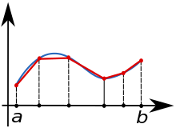

---
header-includes:
        - \usepackage[a4paper,left=1.9cm, right=1.9cm, top=1.5cm, bottom=1.9cm]{geometry}
---


Exam for the course DAT171 Object oriented programming in Python
===========

**Time:** 12th March 2024 8:30-13:30

**Teachers:** Thomas Svedberg (031-772 1522), Mikael Öhman (073-6837674)

**Permitted aids:** Cay Horstmann: Python for everyone. Manuals and lecture notes are available on the computers.

**Teacher will visit the rooms:** Around 10:00 and 12:00

**Formalities**: In each file you hand in, you should write your examination code as well as the computer "number".

The documentation and lectures notes are available on `C:\__EXAM__`. Verify that these files are there immediately.
Handing in the code should be done under the folder: `C:\__EXAM__\Assignments\`, when you are finished. If you do
not store the files here, they are not included in the exam. Save the files for each question in the appropriate folder,
e.g. `C:\__EXAM__\Assignments\Question1\`.
*Make sure you only hand in one solution for each question, otherwise you will receive **zero** points.*
Complex sections of your code should have a descriptive comment of what is achieved.

When you finish the exam you should log out. Fill in the (empty) exam cover page like normal and hand it in.

**Corrections:** The results will be announced through Ladok.
The exam review will be Thursday March 28, 12:20-13:00 at e-Commons (Fysikgården 4, 6th floor).

**Grading:**
There is a total of 25 points which yields grades at the standard 40%, 60%, and 80% limits:
```python
def grade(points):
    if points >= 20:
        return 'Grade 5'
    elif points >= 15:
        return 'Grade 4'
    elif points >= 10:
        return 'Grade 3'
    else:
        return 'Fail'
```

\newpage

# Question 1: (Xp total)

Bla bla bla

Part A (Xp)
-----------

You have been given a file containing hashes for a couple of files, `checksums.txt`.
The format of this file is:
```text
"path to file"  hash_algorithm:hash_in_hex  hash_algorithm:hash_in_hex
...
```
A file can have one or more different hashes.

Write a function `read_checksums` that takes a filename as argument, parses the given file and returns a dictionary that
maps paths to a dictionary of hashes.

```python
>>> checksums_db = read_checksums('checksums.txt')
>>> print(checksums_db)
{'testfiles/correcting_exams.png': {'md5': 'eaee750...', 'sha256':'a53f94...'}, 
...
}
```

*Hint: `defaultdict` from `collections` may be useful.*


\newpage

# Question 2: Numerical integration (6p)

The goal here is to evaluate numerical integration methods available in NumPy and SciPy.
Our main interest is the performance at a certain accuracy.
To benchmark the alternatives, we look at the problem of integrating $$\int_0^5 f(x) dx$$ where $$f(x) = \cos(x) - \sin(x^2).$$

For Part A and B, choose an evenly distributed array of $x$ with $N$ values.

*Hint: numpy.linspace*

## Part A 1.5p

Using a for-loop, evaluate $f(x_i)$ for every $x_i$.
Then use `numpy.trapz` to evaluate the integral by passing in the evluated $f_i$ and $x_i$ arrays.



*Hint: use `help(numpy.trapz)` to quickly check the usage instructions.*

## Part B 1.5p

Instead of looping, use NumPy functions directly on the NumPy array $x$ to evaluate $f(x)$.
Use the trapezodial rule again to evaluate the integral (which should give exact the same answer as Part A).


## Part C 2p

Find a suitable method in SciPy to directly evaluate the integral $\int_0^5 f(x) dx$ (without first evaluating the function).

*Hint: This should be by far the fastest method.*


## Part D 1p

Measure the time needed to compute the integral for the three different methods above. Pick an $N$ so that the accuracy for Part A and B matches that of Part C.

Include the integral results and timing numbers you recieve in a comment block in your code.

*Hint: use `time.time()` to measure the evaluation times.*

\newpage


# Question 3: IP addresses (6.5p)

In your application you need to work with IP addresses and ranges and therefor want classes representing these.

*Note! We are only talking about IPv4 adressess here, these are made up of four groups of numbers, each in the range 0 - 255.
For example www.chalmers.se have the IPv4 address 129.16.225.208.*

## Part A (1.5p)

Create the class **IPAddress** that takes a tuple of four numbers, each in the range 0 - 255, as input for its constructor.
Raise appropriate errors if the input is wrong.

Add a method that enables us to print an object of type **IpAddress**. For example: $print(IPAddress((129,16,225,208)))$ must give $129.16.225.208$.

## Part B (1p)

Add support for comparing two items of type IPAddress by implementing methods for $==$ and $<$.

## Part C (1p)

Create the class **IPRange** that takes a start and and end **IPAddress** as input.

Raise an exception if the end is not strictly larger than the start.

*Note: Here we want the lower address to be included in the range, while the upper is not.*

## Part D (1p)

Implement a method to get the number of addresses in a range, i.e. $len(range)$.

Also here we want to print a **IPRange** object, the output should be of the format $a.b.c.d - e.f.g.h$. 

## Part E (2p)

Add an iterator to the **IPRange** so that we directly can iterate over an object of this type.
Each iteration must return an object of type **IPAddress** representing the current address.

*Note: As described above, the lower limit must be included in the result, while the upper limit msut not.*

\newpage


# Question 4: Machine learning (6p)

In the popular field of machine learning the typical approach is to use multiple layers of different types to process input vectors.
Each layer takes a fixed sized vector as input, and produces a fixed sized vector as output (possibly of different size than the input).

## Part A: Layer base class (1p)

Create an abstract base class **Layer** which:

- stores the `name`, `input_size`, `output_size` (which all layers must have)
- has the abstract method `call` which takes an `input_vector` for processing
- has the method `get_config` which returns a dictionary with the name and input and output sizes (see examples) which can be used for saving a model to disk

## Part B: DenseLayer (1.5p)

Create a subclass of **Layer**, **DenseLayer** which takes a set of `weights` and `biases` (`NumPy` arrays) as input.
Here `weights` is a 2D array where the rows match the input size, and the columns match the output size. `biases` is 1D array which has the same size as the output.

- The constructor takes `weights` and `biases` and should verify that the sizes of them are compatible, if not raise an appropriate exception with a helpful message.
- `call` computes $x \cdot w + b$ where $x$ is the input vector, $w$ are the weights and $b$ are the biases.
- `get_config` should be overloaded to add `type` set to `'DenseLayer'` as well as the additional `weights` and `biases`.

## Part C: Activation (1.5p)

Create a subclass of **Layer**, **Activation** which applies a given function to all elements of the vector.

- The constructor takes a `size` (output size equals input size) and function pointer `fun`. 
- `call`  computes $f(x_i)$ for each element $x_i$ in the input vector. Verify that the input sizes is correct, otherwise throw an appropriate exception with a helpful message.
- `get_config` overloaded to add `type` set to `Activation` as well as the additional `fun`.

## Part D: MultiLayer (2p)

Create a subclass of **Layer**, **MultiLayer** which applies several layers in sequence, passing the output from one as input to the next.

- The constructor takes a list of layers.
- `call` passes the input to the first layer, passing the output of each layer to the next, returning the final output.
- `get_config` overloaded to add `type` set to `'MultiLayer'` as well as the additional `layers` which contain a list of the config for each layer.

\newpage
**Example**:

```python
import math
import numpy as np

weights = np.array([[1, 2, 0, 1], [3, 1, 1, 0], [4, 2, 1, 1]])
biases = np.array([0, 1, 2, 3])
weights2 = np.array([[1, 3], [0, 1], [2, 2], [3, 1]])
biases2 = np.array([2, 4])

start = DenseLayer('start', weights, biases)
process = Activation('process', 4, abs)
middle = DenseLayer('middle', weights2, biases2)
end = Activation('end', 2, math.sqrt)
full = MultiLayer('full', [start, process, middle, end])

print(start.get_config())
print(start.call(np.array([1, 3, 2])))
print()

print(process.get_config())
print(process.call(np.array([-1, 3, -5, 4])))
print()

print(end.get_config())
print(end.call(np.array([1, 3])))
print()

print(full.get_config())
print(full.call(np.array([-1, -3, 2])))
```

**Output**:
```python
{'name': 'start', 'input_size': 3, 'output_size': 4, 'type': 'DenseLayer', 
    'weights': array([[1, 2, 0, 1], [3, 1, 1, 0], [4, 2, 1, 1]]), 'biases': array([0, 1, 2, 3])}
[18 10  7  6]

{'name': 'process', 'input_size': 4, 'output_size': 4, 'type': 'Activation', 
    'fun': '<built-in function abs>'}
[1 3 5 4]

{'name': 'end', 'input_size': 2, 'output_size': 2, 'type': 'Activation', 
    'fun': '<built-in function sqrt>'}
[1.         1.7320508075688772]

{'name': 'full', 'input_size': 3, 'output_size': 2, 'type': 'MultiLayer', 'layers': [
  {'name': 'start', 'input_size': 3, 'output_size': 4, 'type': 'DenseLayer', 
    'weights': array([[1, 2, 0, 1], [3, 1, 1, 0], [4, 2, 1, 1]]), 'biases': array([0, 1, 2, 3])},
  {'name': 'process', 'input_size': 4, 'output_size': 4, 'type': 'Activation', 
    'fun': '<built-in function abs>'},
  {'name': 'middle', 'input_size': 4, 'output_size': 2, 'type': 'DenseLayer', 
    'weights': array([[1, 3], [0, 1], [2, 2], [3, 1]]), 'biases': array([2, 4])},
  {'name': 'end', 'input_size': 2, 'output_size': 2, 'type': 'Activation', 
    'fun': '<built-in function sqrt>'}]}
[4.242640687119285 4.    ]
```


