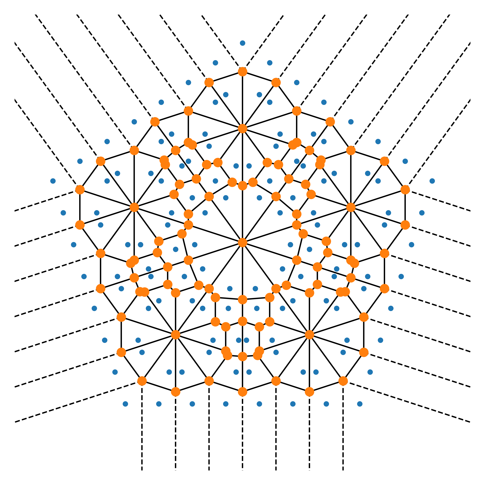

---
header-includes:
        - \usepackage[a4paper,left=1.9cm, right=1.9cm, top=1.5cm, bottom=1.9cm]{geometry}
---


Exam for the course DAT171 Object oriented programming in Python
===========

**Time:** 5th June 2023 8:30-13:30

**Teachers:** Thomas Svedberg (031-772 1522), Mikael Öhman (073-6837674)

**Permitted aids:** Cay Horstmann: Python for everyone. Manuals and lecture notes are available on the computers.

**Teacher will visit the rooms:** Around 10:00 and 12:00

**Formalities**: In each file you hand in, you should write your examination code as well as the computer "number".

The documentation and lectures notes are available on `C:\__EXAM__`. Verify that these files are there immediately.
Handing in the code should be done under the folder: `C:\__EXAM__\Assignments\` when you are finished. If you do
not store the files here, they are not included in the exam. Save the files for each question in the appropriate folder,
e.g. `C:\__EXAM__\Assignments\Question1\`.
*Make sure you only hand in one solution for each question, otherwise you will receive **zero** points.*
Complex sections of your code should have a descriptive comment of what is achieved.

When you finish the exam, you should log out and fill in the (empty) exam cover page like normal and hand this in.

**Corrections:** The results will be announced through Ladok as soon as possible.
The exam review will be on June 19th 12:20-13:00 at Fysikgården 4, 6th floor.

**Grading:**
There is a total of 25 points which yields grades at the standard 40%, 60%, and 80% limits:
```python
def grade(points):
    if points >= 20:
        return 'Grade 5'
    elif points >= 15:
        return 'Grade 4'
    elif points >= 10:
        return 'Grade 3'
    else:
        return 'Fail'
```

\newpage

Question 1: Recipes and calories (6p total)
===========================================
We are working one a simple weight-watcher app and we need to count up the number of calories in various recipes.

Part A (1.5p)
-------------
We have collected a bunch of recipe files that look like `apple_pie.txt`.
Lines that start with `#` are considered comments, and all other lines will be the ingredient followed by the quantity in kilograms after the equal sign.

Write a function `read_recipe` that takes a filename, and returns a dictionary which maps the ingredient to the amount.
Store all ingredients as lowercase.

```python
>> recipe = read_recipe('recipes/apple_pie.txt')
>> print(recipe)
{'apple': 1.5, 'flour': 0.35, 'sugar': 0.1, 'brown sugar': 0.1, 'egg': 0.06,
 'butter': 0.2, 'salt': 0.0001}
```

Part B (2.5p)
-------------
We have managed to collect a huge amount of calorie information for many ingredients.
The data contains the name of the ingredient and the amount of energy per 1kg (separated by a colon).
It also contains blank lines here and there which we just ignore.

Unfortunately, the data we managed to collect mixed a bunch of units. Rather than fixing it by hand you should write a function that manages to deal the units.
You must account for: `J` for joules, `cal` for calories, as well as the prefix `k` for kilo (no other units will appear). The conversion rate is $1\,\text{cal} = 4.184\,\text{J}$.
It was also collected from all kinds of sources, so spacing and capitalisation, so to test your code a small sample of what we can expect is available as `calorie_data.txt`.

Write a function `read_calorie_data` that takes a filename, and returns a dictionary of all the ingredients (in lowercase) and their corresponding energy density measured in calories per kg

```python
>>> calorie_data = read_calorie_data('calorie_data.txt')
>>> print(calorie_data)
{'apple': 520000.0, 'tomato': 179254.30210325046, 'banana': 890000.0, 'lettuce': 150000.0,
 'salt': 0.0, 'brown sugar': 3800000.0, 'sugar': 3871892.9254302103, 'flour': 3641252.390057361,
 'egg': 155000.0, 'olive oil': 8840000.0, 'parmesan cheese': 4310000.0, 'goat cheese': 3640000.0,
 'milk': 420000.0, 'cream': 1959990.4397705544, 'butter': 7170000.0, 'ice cream': 2070000.0,
 'milk chocolate': 5350000.0, 'dark chocolate': 5460000.0, 'chicken breast': 1650000.0,
 'chicken drumstick': 1590000.0}
```

Part C (1p)
-----------
Write a function `count_calories` that takes a recipe dict and a dict of calorie data and returns the total amount of calories for the given recipe.

Part D (1p)
-----------
Loop over all files in the `recipes` directory and use the functions above to compute the number of calories.
Print the recipe name and the number of calories without decimals.

Write your code so that it works regardless of how many recipes we have.

Expected output with the given example files:
```
banana_split.txt has 1126499 calories
chicken_salad.txt has 1302276 calories
apple_pie.txt has 4264928 calories
```


Question 2: Complex art and Voronoi diagrams (6p total)
=================================================

To any set of points in the two dimensional plane the Voronoi partition is a set of equally many polygons, where every polygon covers the area which is closest to one particular point compared to the other points in the set. In SciPy there are utilities for constructing the Voronoi polygons and for visualising them, given a set of point coordinates in the plane.

You would like to use this functionality to generate interesting geometrical figures. In order to do this you first need to write a program that generates an interesting set of points in the plane.

Your lecturer in maths (who likes complex numbers) propose the following iterative formula:

1. Start with an array $A$ containing the (complex) number zero, $A = [0]$ and the radius $r=1/2$.
2. For each complex number $z$ in $A$,
   a. generate $N_p$ new complex numbers $z_n$, $0 \le n < N_p$ using the formula
      $$ z_n = z + i r e^{i n \theta} $$
      where $r$ is a given radius, the rotation angle $\theta$ is $\theta = 2\pi / N_p$, 
	  and $i$ is the imaginary number ($i \equiv \sqrt{-1}$), and
   b. replace $z$ in $A$ with the numbers $z_n$.
3. Scale the radius $r$ with a factor $1/2$, $r := r/2$.
4. Iterate $N_{iter}$ times from point 2.
5. Get the $x$ and $y$ coordinates as the real and imaginary part of the complex numbers $z$ in $A$, 
   i.e. $x = \text{Re}[z]$, $y = \text{Im}[z]$.

Part A (2p)
-----------

**Task:** Implement the operations in step 2 above in the function
```python
def new_rotated_points(A, N_p, r):
   ...
   return A_new
```
that takes an (NumPy) array of points `A`, the number of new points to generate (per input point) `N_p`, the radius `r` (as a float), and returns an array `A_new` with the new points.

**Test:** Your implementation of `new_rotated_points` should produce the output:
```text
N_p = 2 : A = [ 0.00+0.50j -0.00-0.50j]
N_p = 4 : A = [ 0.00+0.50j -0.50+0.00j -0.00-0.50j  0.50-0.00j]
N_p = 6 : A = [ 0.00+0.50j -0.43+0.25j -0.43-0.25j -0.00-0.50j  0.43-0.25j  0.43+0.25j]
```
when called by the test code:
```python
np.set_printoptions(precision=2, floatmode='fixed', suppress=True, linewidth=1000)
for N_p in [2, 4, 6]:
    A = new_rotated_points(np.array([0.]), N_p=N_p, r=0.5)
    print(f'N_p = {N_p} : A = {A}')
```

Part B (2p)
-----------

**Task:** Implement the steps 1 to 5 above in the function
```python
def generate_point_set(N_p=5, N_iter=3, r=0.5):
   ...
   return x, y
```
that takes the number of new points to generate `N_p` (per iteration), the number of iteration `N_iter` and the initial radius `r` and returns two arrays `x` and `y` with the x- and y-coordinates of the generated points.

**Test:** Check that your implementation produces the result
```
[ 0.00 -0.50 -0.00  0.50 -1.00 -1.50 -1.00 -0.50 -0.00 -0.50 -0.00  0.50  1.00  0.50  1.00  1.50]
[ 1.50  1.00  0.50  1.00  0.50  0.00 -0.50 -0.00 -0.50 -1.00 -1.50 -1.00  0.50 -0.00 -0.50 -0.00]
```
when called with
```python
print('{0}\n{1}'.format(*make_points(N_p=4, N_iter=2, r=0.5)))
```

Part C (2p)
-----------

Combine your point set generator with the Voronoi diagram builder and plotter from SciPy (see `scipy.spatial.Voronoi` and `scipy.spatial.voronoi_plot_2d`) and write code that reproduces the plot in Fig. 2 generated from the point-set with `N_p=5`, `N_iter=3`, `r=0.5`.

{ width=100% }

\newpage

Question 3: OneHotVector (6p)
===============================
In some applications there is a need for a special vector where only a single element is set to 1, the rest being zero.
The is typically called a `OneHotVector`.

Part A (1p)
-------------
Create the class `OneHotVector` that takes a length and the index of the nonzero element.

Part B (0.5p)
-------------
Add a nice looking `repr` implementation.

Part C (0.5p)
-------------
Implement support for `len(x)` on your `OneHotVector`.

Part D (1p)
-------------
Implement support for scalar indexing (just getting the items, not assignment).
Also add support so that negative indexes work (starting from the end).

Part E (1p)
-------------
Add the method `toarray` which returns the a NumPy array version of this vector.
Have it take an optional argument of what datatype to use in the NumPy array, with a default value of `int`.

Part F (1p)
-------------
Implement support for a dot product between the vector and a matrix (NumPy array) by adding a `dot` method that computes $v \cdot M$ for a vector $v$ and matrix $M$.
Since where is just 1 nonzero value, this simply means extracting the corresponding row which can be done very efficiently.

Part G (1p)
-------------
Add bounds checking to Part A, D, F and raise an `IndexError` with appropriate messages when indices or dimensions don't match.

\newpage


Question 4: Flexible log sinks (7p total)
=========================================
Larger complex software needs customizable logging. A typical approach is to construct a "sink" that can receive messages.

Part A (1p)
-----------
Make a Enum called `LogLevel` with increasing severity: `debug`, `info`, `warning`, `error`.
The Enum must be comparable.

Part B (2p)
-----------
Write a base class `LogSink` that takes the parameter `minimum_log_level`.
It should have:

- an abstract method `_write(self, entry: str)`
- a static method `datestamp() -> str` that returns the current date and time in ISO format; e.g.
  `'[2019-03-19T11:31:23.135252]'`
- a method `push(self, importance: LogLevel, msg: str)` that, if the importance level is at or above the minimum log level, prepend the datestamp to the message and send the resulting string to `_write`.

*Hints: `datetime.datetime.now`*

Part C (0.5p)
-------------
Implement the subclass `PrintSink` that simply prints to standard output.

Part D (0.5p):
--------------
Implement the subclass `FileSink` which in addition to the minimum log level also takes a filename of the file to write output to (one entry per line).

*For the sake of managing the complexity of this question on the exam, you are allowed to "leave" this file handle open*

Part E (1p)
-----------
Implement the subclass `MemorySink` which in addition to the minimum log level also takes a `maxlen` parameter.

The 'MemorySink' class should store at a maximum 'maxlen' messages, when the maximum number of messages are logged, the oldest
message should be overwritten.

Implement a suitable method which enables us to loop over the messages, see the example below.

*Hint: check out `collections.deque`*

Part F (2p)
-----------
Write a subclass `MultiSink` that takes a list of other `LogSinks`.
Overload `push` so that we can put the exact same datestamp on all the sinks.


\newpage
**Example**
```python
ps = PrintSink(LogLevel.info)
fs = FileSink(LogLevel.warning, 'logfile.txt')
multi = MultiSink([ps, fs])

multi.push(LogLevel.info, 'Multi-test: Stuff happened.')
multi.push(LogLevel.error, 'Multi-test: An error occurred!')

ms = MemorySink(LogLevel.warning, 5)
for test_message in ['A', 'B', 'C', 'D', 'E', 'F', 'G']:
    ms.push(LogLevel.warning, test_message)

for event in ms: # Should display C trough G
    print('MemorySink:', event)
```
**Output**
```text
[2024-05-28T15:51:34.532546] - Multi-test: Stuff happened.
[2024-05-28T15:51:34.532585] - Multi-test: An error occurred!
MemorySink: [2024-05-28T15:51:34.532621] - C
MemorySink: [2024-05-28T15:51:34.532623] - D
MemorySink: [2024-05-28T15:51:34.532625] - E
MemorySink: [2024-05-28T15:51:34.532626] - F
MemorySink: [2024-05-28T15:51:34.532628] - G
```
Logfile should contain
```text
[2024-05-28T15:51:34.532585] - Multi-test: An error occurred!
```
