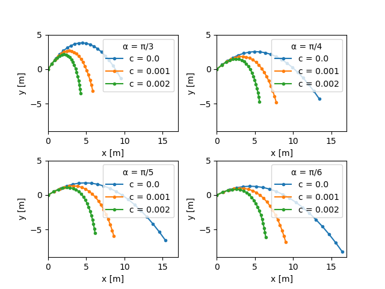

# Question 2: Projectile motion (5p)

The state of a projectile is described by the state vector $\boldsymbol{s}$ containing its velocity,
$\boldsymbol{v} = [v_x, v_y]$, and position, $\boldsymbol{p} = [p_x, p_y]$:
$$
\boldsymbol{s} = 
\begin{bmatrix}
v_x \\
v_y \\
p_x \\
p_y
\end{bmatrix}
$$
The motion of the projectile is described by the following ordinary differential equation (ODE):
$$
\frac{\mathrm{d}\boldsymbol{s}}{\mathrm{d} t} = 
\begin{bmatrix}
\dot{v}_x \\
\dot{v}_y \\
\dot{p}_x \\
\dot{p}_y
\end{bmatrix} =
\begin{bmatrix}
W_x / m\\
-g + W_y/m\\
v_x \\
v_y
\end{bmatrix}
$$
where $m = 0.1\ \mathrm{kg}$ is the mass of the projectile, and $g=9.82\ \mathrm{kg\ m/s^2}$ the gravitational
acceleration.
$\boldsymbol{W} = [W_x, W_y]$ represent the air resistance, and can be computed as
$$
\boldsymbol{W} = - c\ |\boldsymbol{v}|^2\ \boldsymbol{e}_v,
$$
where $c$ is a model parameter (see below), $|\boldsymbol{v}|$ is the norm of the velocity vector, and $\boldsymbol{e}_v$
is a unit vector in the direction of the velocity, i.e.
$$
\boldsymbol{e}_v = \frac{\boldsymbol{v}}{|\boldsymbol{v}|}.
$$
The initial conditions for the ODE, $\boldsymbol{s}_0$ is parametrized with an angle $\alpha$:
$$
\boldsymbol{s}_0 = 
\begin{bmatrix}
v_{x,0} \\
v_{y,0} \\
p_{x,0} \\
p_{y,0}
\end{bmatrix} = 
\begin{bmatrix}
10 \cos(\alpha) \\
10 \sin(\alpha) \\
0 \\
0
\end{bmatrix}
$$

Part A (2p)
-------------

**Task:** Write a function `time_derivative(s, t, params)` that evaluates and returns the
time derivative of the state vector $\boldsymbol{s}$, i.e. $\mathrm{d}\boldsymbol{s}/\mathrm{d}t$ as described
by the equation above.

Input:

* `s: numpy.ndarray`: the (current) state vector $\boldsymbol{s}$ containing $v_x$, $v_y$, $p_x$ and $p_y$,
* `t: float`: the current time,
* `params`: problem parameters (e.g. the mass, gravitational acceleration, wind resistance parameter `c`).

Output:

* A `numpy.ndarray` containing the 4 elements of $\mathrm{d}\boldsymbol{s}/\mathrm{d}t$.

Part B (1.5p)
-----------

**Task:** Write a function `simulate_projectile(ang, c)` that integrates the ODE, for the specified initial state
$\boldsymbol{s}_0$, for (at least) 20 timesteps between `0` and `T`.
Use `scipy.integrate.odeint` with the `time_derivative` function from Part A.

Input:

* `ang: float`: the angle $\alpha$ for specifying the initial condition $\boldsymbol{s}_0$,
* `c: float`: the model parameter for the wind resistance.

Output:

* A `numpy.ndarray` containing the (integrated) state vectors for each timestep.

Part C (1.5p)
-----------

**Task:** Run the simulation for 4 different angles, $\alpha = [\pi/3, \pi/4, \pi/5, \pi/6]$, and 3 different values of
the wind resistance parameter, $c = [0.0, 0.001, 0.002]$.
Use `matplotlib` to create a plot with 4 subplots (one for each angle $\alpha$). Each subplot should include three lines (one for each $c$)
showing the flight path of the projectile.
Each subplot must have (i) x- and y-labels, and (ii) a legend that makes it clear which line corresponds to which value of `c`.
It must also be clear which subplot corresponds to which initial angle $\alpha$.

An example plot is included below. It is not necessary to copy/replicate this plot exactly, it merely serves as an example of
what is considered to be full points for Part C.

\newpage
